# Final project plan

---

## 컨셉

* 로블록스 비슷한 공간, 근데 "게임"이라기보단 사람들 모여서 소통하는 실시간 소셜 공간.
  
  * 참고: Gather.town, VRChat lite 느낌
  
  * 3D로 구현할 거고, 3인칭 시점을 지원한다 (생각보다 크레딧이 많아서 3d로 결정)
  
  * 게임과 비슷하게 실시간 채팅, 음성 채팅(후순위)이 가능하고, 물건과 상호 작용이 가능하다
  
  * "우편" 기능으로 비 접속시 확인할 수 있는 우편 기능을 도입
  
  * 언제 어디서나 '스티키 노트'를 붙여 흔적을 남길 수 있다. 하단 인터랙션 파트 참고

- 만들고자 하는 방향
  
  - ANUHub (공간)
    
    - 현재 ANU Hub의 고민은, 비 공식적인 Staff(특히 교수)랑 학생의 접점이 없다는 것이다.
    
    - 학생들은 연구 지도교수를 찾고, 지도교수는 관심 있어하는 학생을 쉽게 찾을 수 있다. 친목도 가능.
    
    - 게시판 UI를 열어서, 랩실 홍보하기, 학생이 랩실 구하기 게시물을 쓸 수 있음. 순전히 본인 선택. 실제 서비스가 아니므로 교수랑 학생 구분은 불가능하니까 이는 감안한다
    
    - 그 외에 ANUHub에서 지원하는 내용을 이 가상의 공간에서 지원한다.
    
    - 크게 생각하는건 네 가지인데
      
      - 연구지도교수/학생 찾기 게시판 - 교수를 인증할 방법이 없으므로 게시글 UI를 띄워 교수 탭 / 학생 탭 각각 랩실구해요 학생구해요 이런 게시글 작성하는 것으로 
      
      - 홍보 게시판(건물 외부에 존재 - 동아리 및 이벤트 등 홍보
      
      - 1:1 채팅방
        
        - 파일 첨부(png jpg pdf 5mb까지 허용)
        
        - 실시간 음성 채팅(후순위로 미룸. 가능하면 진행)
        
        - 텍스트 채팅
      
      - ANU Hub에 문의하기
        
        - (게시판에 문의글 남기기 - 메모: 공식 서비스가 아니라는 점을 고지) 이 정도?
  
  - '강의실'
    
    - ~~학생들은 수강 중인 강좌의 온 에어중인 echo360을 실시간으로 보고 댓글을 달 수 있다.~~
    
    - ~~교수 및 학생의 파일 공유도 가능하다~~
    
    - 위 취소선 내용을 사실상 불가능.  강의 시간대에 맞춘 댓글판이나 질문판을 운영하는 것으로 만족
    
    - 강의실명은 MGMP2222, COMP6300이런 형태이고, 방의 유효기간은 6개월(한 테이블에 강의실 행을 두고 6개월 지난 행을 삭제하는 방식)
    
    - 강의실은 qa_master만 만들 수 있다. 일단 초기 강의실은 COMP8020 하나만 생성
  
  - (보류) - 클럽
    
    - 동아리(클럽) 공간
    
    - 클럽을 홍보하고 가입할 수 있다.
    
    - 클럽룸이 있어서 커스터마이징 및 회의가 가능하다 
  
  - (보류) - 기숙사
    
    - 기숙사 룸에서 커뮤니티 사교활동 가능
  
  - (보류) - 대학(CSS)공간 내에 강의실처럼 쪼개진 코스(MCOMP)공간들. 자신의 대학/코스만 입장 가능
    
    - 대학 및 코스의 공지사항을 전파하고, 문의를 남길 수 있다.
    
    - 물론 선배를 마주치면 인사해서 친해질 수 있음
    
    - 애초에 교수 찾기를 여기로 넣을지도 생각 중. 여기에 넣으면 타 학과 연구실과는 접점이 없어지겠지? 음..

---

## 기술 스택

- 영속 데이터: SQLite를 volume에 두고 접속 종료 좌표와 아이템 기록을 저장해요. 쓰기는 접속 종료 시점이나 몇 초 간격으로 한다

- 실시간 위치: 서버 메모리에 Map<playerId, {x,y,z,rot}>로 두고 WebSocket으로 브로드캐스트한다. 초당 10~20회 정도의 틱으로 보내면 됨. DB에는 쓰지 않음

- 통신: 채팅 같은 메시지도 WebSocket 기록이 필요하면 SQLite 테이블에 쌓음.

- 클라이언트 렌더링: WebGL (Three.js나 Babylon.js)

- 실시간 동기화: WebSocket > Crit8에는 실시간 동기화 불 필요. 다만 스티키 노트를 남길 떄 위치(좌표)는 즉시 DB에 저장 되어야 함
  
  - 서버 프레임워크 후보: Colyseus (room 기반 상태 동기화, 직접 구현보다 서버 코드량 줄어듦)

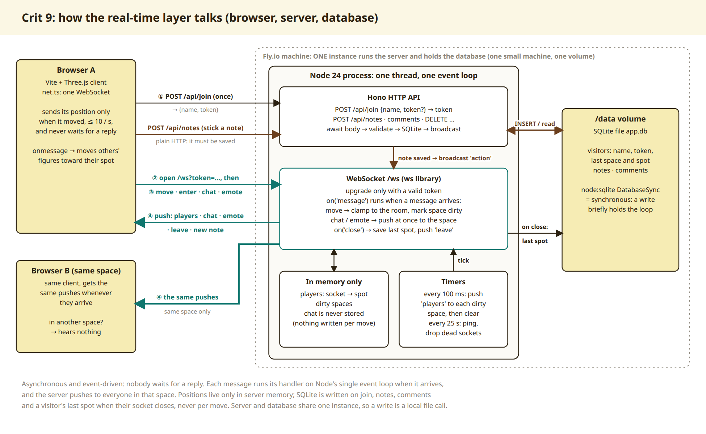

> 클라이언트 (client/src/net.ts)
> 
> - 내 위치는 일정 간격마다 보내는데, 그 사이에 움직였을 때만 보냅니다. 가만히 서 있으면 아무것도 보내지 않습니다.
> - 보낸 뒤 서버의 답을 기다리지 않고 화면 그리기를 계속합니다.
> - 다른 사람의 움직임은 ws.onmessage로 언제든 도착하고, 도착하면 그 사람 위치 목표값만 바꿔 둡니다. 실제 캐릭터는 매 프레임 그 목표를 향해 부드럽게 따라갑니다.
> - 연결이 끊기면 다시 연결을 시도하는데, 간격을 점점 늘려서 최대 8초까지 기다립니다.
> 
> 서버 (server/realtime.ts)
> 
> - Node.js는 스레드 하나의 이벤트 루프로 돌아갑니다. ws.on("message"), ws.on("close") 같은 콜백이 메시지가 올 때마다 실행되므로, 한 사람을 처리하느라 다른 사람이 막히지 않습니다.
> - 받은 위치를 바로 모두에게 돌리지 않습니다. 해당 공간에 "변경 있음" 표시만 해 두고, 타이머(setInterval)가 1초에 10번 정도 바뀐 공간에만 한꺼번에 보냅니다.
> - 요청에 응답하는 구조가 아니라 서버가 먼저 보내는(push) 구조입니다. 같은 공간에 있는 사람에게만 보냅니다.
> - 응답 없는 연결은 주기적인 ping으로 찾아내서 끊습니다.
> 
> 한 가지 예외: DB 저장은 동기식입니다.
> 
> - node:sqlite의 DatabaseSync를 쓰기 때문에, 노트를 저장하거나 접속을 끊을 때 마지막 위치를 저장하는 순간에는 이벤트 루프가 아주 잠깐 멈춥니다.
> - 실시간 위치는 메모리에만 두고 움직일 때마다 DB에 쓰지 않기 때문에 지금 규모에서는 문제가 없습니다. CLAUDE.md 규칙대로입니다.
> - 결정 기록이나 crit에서 "전부 비동기냐"는 질문을 받으면 "통신은 비동기, SQLite 쓰기는 동기지만 이동할 때마다 쓰지는 않는다"고 답하시면 정확합니다.

---

## 배포 (Fly.io)

- ~~기본 course 설정은 scale-to-zero (`min_machines_running = 0`) → 비용은 거의 안 들지만 WebSocket 상시 연결과 궁합 안 좋음~~
- ~~데모/크리틱 때는 `min_machines_running = 1`로 always-on 전환 고려~~
- 학교가 보는 설정이니 건드리지 말라고 하니 0으로 유지한다. 에효
- always-on 비용이 course 예산 범위 안에 드는지 불명확 → comp4020@anu.edu.au에 문의 필요
- [https://comp4020-final-passionleader.fly.dev/](https://comp4020-final-passionleader.fly.dev/) 띄워 둔 상태

---

## Claude Code 예산

- $300 Sonnet 예산이면 이 스코프엔 충분해 보임
- 비용 절약 팁: 세션을 자주 새로 열지 말고 하나로 길게 이어가기 (cold start마다 ~$0.10 고정 비용)
- WebGL 디버깅할 때 스크린샷 반복 첨부가 비용 많이 먹는 요인이니 주의 (하지만 예산 남으면 감당 가능)

---

## 맵 디자인

* ANU캠퍼스 사진과 위성지도 캡쳐를 참고용으로 첨부할 예정. 필요시 나한테 요청해라
  
  * OpenStreetMap 건물 윤곽(출처 표기)을 바탕으로 사용도 가능

* 캠퍼스 (제일 외부 맵)만 실제와 비슷한 느낌으로 진행

* 강의실/건물 내부는 커스터마이징 가능 

* 맵은 하나로 전부 구현하지 말고, 문 앞에서 E키를 눌러 장소 이동하는 방식으로 공간 하나씩마다만 렌더링한다

---

## 어셋

* BGM은 Gemini로 생성된 AI음악 사용 예정, 이 점 고시 필요. 필요할 때마다 나한테 브금 만들어 달라고 하기

* 어셋은 직접 생성하거나 웹으로부터 무료 어셋 사용한다

---

## 캐릭터 디자인

* 단순한 사람 형태

* 커스터마이징: 피부 색, 머리 색깔, 눈 색깔, 옷의 색 정도로 생각 중임

---

## 조작

* WASD로 조작한다, space로 점프한다, ESC로 환경 설정(음량 조절, 그래픽 설정, 라이선스  확인, 크레딧_만든사람, 언어) 가능.

* Q로 인터랙션 메뉴 (GTA5 무기 고르는 창처럼) 표시
  
  * 포스트잇 생성
  
  * 인사하기
  
  * 네 / 아니오
  
  * How ya doing mate (말풍선)
  
  * 춤추기

* E로 상호작용
  
  * 게시판 열기
  
  * 포스트잇 보기
  
  * (문 앞에서) 맵 입장하기

* F 버튼을 누른 상태로 대화할 수 있음. 

* 엔터 버튼으로 채팅도 가능함 엔터 누르면 캐릭터 위에 말풍선으로 띄운다

* 왼쪽 하단에 채팅창이 있고, 채팅 내역은 1분이면 사라짐 ~~(번역 기능 추가 가능하려나, 환경 설정에서 고른 언어로 번역됨)~~

* 기본 가이드는 현재 구현된것과 같이 가이드라인을 하단에 표시한다.

---

## 그래픽

* 너무 찰흙같지 않으면 됨. 

* 낮은 사양에서 고품질이면 좋겠는데.. 바닥 벽돌 등

* 물론 모바일 웹에서 돌릴 수 있는 사양이어야 함

* 환경 설정 - 그래픽 옵션에서 저사양용(찰흙같은 그래픽 가능), 및 고사양용 선택 가능하면 좋을듯. 그림자도 켜고 끌수 있음 좋겠다

----

## 로직(원하는 기능)

- 인증하기
  
  - ~~학생인증, 임직원 인증 기능 만들 수 있으려나... 아무튼 anu.edu.au 이메일 있어야만 사용 가능~~
  
  - ~~위 기능은 회원가입 시에 인증절차를 거친다.~~
  
  - ~~이게 불가능하다면, 애초에 처음 닉네임 고를때 ex) 학번 + 비밀번호 생성으로 진행~~
  
  - ~~게스트로 진행 가능하며, (인증 구현이 된다면) 게시글 작성 등에서 인증이 필요한 기능으로 인증 화면을 띄움~~
  
  - 위 취소선 내용 사실상 불가능하니, 닉네임으로 진행한다

---

## QA진행

* 작업 후 qa_bot01~10으로 테스트를 진행한다 (미리 DB에 만들어 둠)

* 마스터 계정도 미리 만들어 두어야 함(qa_master) -> 이건 관리자 전용 계정으로 내가 접속할 거임

* QA역할로 어떤 점이 이상한지 클로드 코드가 직접 검증 진행. 브라우저를 직접 컨트롤 해도 되고 브라우저 로그/렌더링 오류 같은거 같이 봐야 함.

* 테스트를 위해 그 어떤 짓도 해도 됨. DB 버그를 발견해서 무한 포스트잇을 쓴다던가.. 다만 발견했으면 고쳐야겠지?
- 관리자 및 테스트 계정 위치
  
  - `qa_master`(관리자), `qa_bot01` ~ `qa_bot10`(일반 사용자) 비밀번호는 저장소 밖 파일에만 있음 (본인만 읽기 가능, 권한 600).
  - 공개 저장소(학교/개인 둘 다)에는 비밀번호를 절대 넣지 않는다. 

---

## 문서화

* CLAUDE.md에 넣을 규칙(이미 적용되어 있을 것이다.)
  
  * "커밋은 기능 하나씩 작게"
  
  * 모든 문서는 영어로 작성
  
  * 내가 작업을 줄 때마다 process.md 하단에 "history"로 커밋넘버와 함께 간단히 기술해 둘 것
  
  * 주차가 변경되었을 때 이 부분은 초기화 되고 덮어쓴다 (week8에 쓴 히스토리는 week9작업 시작 시 제거)

* 아무튼 process.md 하단에 히스토리 짧게 커밋넘버와 쓰도록.

### Final Project 과정 리플렉션

* What is good (readme.md에 적용할 것)
  
  * (중요 최종과제에 쓸거) 친숙한 공간을 모바일로 모델링 하여 거부감이 없도록 한다 (익숙한 공간의 중요성 > 레퍼런스 첨부할 것 찾아야 함)
  
  * good thing should be already good itself even though we don't say it is good
  
  * (중요 최종과제에 쓸거) 3D공간이 주는 특성: 매일 업무할 때 보는 2d 공간이 아니라 누구라도 편히 쉴 수 있는, 마치 게임과 같은 공간을 제공하고 싶었다. 따라서 BGM과 외관 디자인 등에 큰 노력을 쏟았다
  
  * (중요 최종과제에 쓸거) 오프라인으로 쑥쓰러운 사람들에게 온라인으로 사교 활동을 진행할수 있음. 학생과 교직원의 허물 없이 누구나 쉬운 커뮤니케이션을 지향한다. 단순 채팅, 이모티콘, 팀워크, 음성 채팅(예정) 을 지원한다
  
  * (Crit9에 적용) 실시간으로 학급 동료들을 마주치고, 인사하고, 대화를 건네는 친숙한 공간을 만들고 싶었다. 원하면 Sticky Note 를 붙여 나의 흔적을 기록하고 학급 친구들이 댓글을 달아 소통에 재미를 더한다. 같이 춤도 출 수 있다.
  
  * (중요 최종과제에 쓸거)anu와서 제일 불편했던건 교내 커뮤니티가 없어서 불편했거든, 모르는걸 어디에 물어봐야 하는지 참.. 그래서 학생들을 위한 커뮤니티를 만들기로 결정함. 정책은 어떻게 되는지, 이건 어디에 물어봐야 하는지..
  
  * (중요 최종과제에 쓸거)또한 최근 다른 과목의 몇 개의 과제를 진행하면서 알게된 사실이 Student Hub에서 고민거리가, 학생이랑 교수진의 정규시간 외 접점이 없다는 거다. 학생들도 Student Hub에서 자신의 이야기를 털어 놓는데에 부담을 가지고 있는다. 따라서 스탭과 학생이 시공간적 제약 없이 쉽게  어우러 질 수 있는 그런 장소를 만들고 싶었다. 맵 곳곳에 보면 게시판이 존재하는데, 이들은 이러한 내 바람을 반영한 요소이다. (EdSTEM은 CSS등의 단과대학에서만 지원하는 커뮤니케이션 방법이지만 이러한 커뮤니케이션 공간을 ANU 모든 학생이 누렸으면 좋겠다.)
    
    * (중요 최종과제에 쓸거) 코스워크 학생들은 원하는 연구실을 쉽게 찾고, 반대로 교수들도 원하는 스펙의 학생을 쉽게 찾을 수 있는 게시판도 만들어 두어 연구 활성화를 도모한다
    
    * (중요 최종과제에 쓸거) 공용 공간에 있는 Q&A게시판으로  대학에 익숙하지 않은 신입생이나 교환학생, 유학생들이 모르는 것을 부담 없이 물어보고 답변할 수 있는 그런 커뮤니티가 절실했다. 나는 이런 공식 게시판이 없어 학년 초에 많이 힘들었다. 
    
    * (중요 최종과제에 쓸거) 캠퍼스 내의 게시판에 덕지덕지 붙어있는 광고 포스터들은 금방 낡아 보기도 더럽고  학생들이 잘 보지도 않는다. 공식적으로 웹으로 깔끔하게 홍보하는 채널이 있으면 좋겠다고 생각했다.
    
    * (중요 최종과제에 쓸거) 사실 나는 이번 학기에 HCI및 Responsible Practice 과목을 들으며 몇 차례 인터뷰를 진행하였다. 이미 제출한 과제이고 윤리적으로 문제가 될 수 있어 인터뷰 내용은 공개하기 어려우나, 개인적으로 ANU 구성원들이 편히 소통할 수 있는 공간이 필요하다고 판단하였다. 내가 이 Crossing ANU를 만들게 된 계기이다.
  
  * (중요 최종과제에 쓸거) 이름 - Crossing ANU - Crossing Paths(우연히 마주침)에서 따왔다. 교수진, 스태프, 학생들이 우연히 가상 현실 세계에서 마주쳐 실제 깊은 인연이 되었으면 하는 바람이 담겨있는 프로젝트 이름이다.
  
  * (중요 최종과제에 쓸거) Final Assignment 3 에서 끝나지 않고 실제로 내 프로젝트가 실제로 채택되어서 내년 O-Week때 신입생이 들어와서 커뮤니티를 형성할 수 있도록, 실제 서비스와 같이 기능과 완성도에 신경을 많이 썼다. 실제로 이 프로젝트가 제대로 진행되면 좋겠다.
  
  * (중요 최종과제에 쓸거) 배경음, 어셋 등에 특별히 신경을 많이 썼다. 맵은 ANU캠퍼스와 최대한 유사하도록 직접 사진을 찍기도 했고 그림도 많이 그렸다. 음악은 Gemini를 쓰긴 했지만 마음에 드는 스타일의 음악이 나올 때 까지 수도없이 반복했다. 전경을 캠퍼스와 비슷하게 만들어 친숙함을 느끼는 공간을 만들고 싶었고, 음악을 통해 활기찬 캠퍼스의 느낌을 주고 싶었다. 참고로 나는 만든 음악이 좋아서 음악을 들으려고 내 사이트를 항상 띄워 둔다

* 구현 전
  
  * (중요 최종과제에 쓸거) ANU Library 자료 검색 등 창을 E키 만으로 손쉽게 찾아서 원하는 페이지에 쉽게 접근할 수 있다.
  
  * (중요 최종과제에 쓸거) 아직 구현 전이긴 한데, 협업할 수 있는 워크스페이스를 메타버스로 구현하여 실제로 쓸모가 있도록 하는 것이 목표이다.

* 리플렉션
  
  * (crit 10에 적용) 아이디어는 언제 어디에서 좋은 아이디어가 떠오를 지 모른다. 나는 아이디어가 떠오를 때마다 메모해 두고, 추후 작업할 리스트로 남겨 두는 방향으로 진행했다
  
  * (crit 10에 적용) UX는 인공지능이 모른다! 뭐가 불편하고 뭐가 편한지 이 관점을 잘 모름. 이건 인간의 경험으로만 수정하고 개선할 수 있는 영역이다! 
  
  * (crit 10에 적용) 배경음, 어셋 등에 특별히 신경을 많이 썼다. 다만 인공지능은 실제 현실이 어떻게 구현되었는지 알 지 못하여 직접 그림을 그리거나 사진을 찍어서 제공했어야 했다. 아무리 LLM이 뛰어나다고 해도 현실에 있는 데이터를 완벽히 옮기기는 부족하므로, 이와 관련 직무가 생길  수도 있다는 생각이 들었다.
  
  * (crit 10에 적용) S3(구현 완료) 등  AWS 인프라를 사용하는 쪽으로 진행 하였는데, 이를 진행하면 느낀  점은, 인프라 스트럭쳐는 여전히 사람의 손이 필요하다는 것이다. 최소한 IAM권한을 주어서 필요한 권한만 서버 혹은 LLM에 부여해야 한다. 인공지능은 권한 관리를 알아서 진행해 주지 못하며, 설령 가능할 지라도 매우 리스크가 크다. 따라서 앞으로 권한 관련해서 개발자로써의 인간의 중요성이 더 커 질것으로 보인다. 나는 이와 관련하여 클라우드 권한 관리자로써의 커리어도 생각 중이다.
  
  * (crit 10에 적용) 현재 Fly.dev 구현은 단일 서버에 여러 프로세스 (DB, 서버 등)로 구성되어 있어 해킹이 취약할 것으로 보인다. 심지어 S3의 경우 하나의 버킷으로 채팅 첨부파일, 게시판 홍보 파일 등이 전부 공유되는 버킷이다. 현재 S3 접근용 IAM계정은 분리해서 서버에 제공해 주었으나, 향후 이 프로젝트를 본격적으로 진행할 경우, 외부에서 접근 가능한 인스턴스(서버), 외부에서 접근 불가능한 DB 등을 잘 구분하여 보안적인 개선이 필요할 것으로 보인다. 또한 파일의 기밀성 필요도에 따라 S3버킷 구분도 필요할 것으로 예상된다.
  
  * (중요 최종과제에 쓸거)구현은 이제 AI를 통해 아주 쉽게 가능하다. 원하는 프로그램을 만들어서 웹 브라우로 접근할 수 있도록 아주 쉽게 배포하는것도 가능하다. 이렇게 되면 데이터와 컨텐츠가 넘쳐나고 사람은 쉽게 싫증을 느끼게 된다. 따라서 나는 구현이 쉬워질 수록 user를 알아야 한다고 생각한다. User 가 정말 필요한 needs는 무엇인가? User 가 내 서비스에서 불편한 점이 무엇인가? 이것들은 모두 '인간의 experience'에서 나오는 sense이므로, AI가 대신 찾아주지 않는다. 이것들이 충족되지 않으면 그저 AI를 통해 양산 해 낸 수많은 쓰레기 컨텐츠 중 하나가 될 뿐이다. 대충 만든 프로토타입보다 완성도 높은 실제 서비스를 잘 만들어서 이목을 끄는게 아주 중요하다. 추진력과 섬세함을 두루 갖춘 '살아남는' 개발자가 되고 싶다. 

* (crit 10에 적용) 기획 노트 → 제출 문서: `Integreted_plan.md`(무엇을, 왜)와 `Integreted_checklist.md`(번호 붙은 할 일·✅·커밋)를 한국어로 직접 쓰고, 이를 바탕으로 에이전트가 저장소의 영어 문서(`docs/plan.md`, `CLAUDE.md`, `docs/roles.md`)를 만들고 최신화하게 했다. 제출 문서(README·PROCESS·reflection·결정 기록)는 이 노트를 재료로 내가 직접 쓴다. 채점자는 저장소 밖 노트를 못 보므로, 노트가 저장소로 옮겨진 커밋을 링크할 것: 56b1b99(crit 10 계획·역할), 238efdf(`docs/roles.md` 두 세션 역할), b83c85b(crit 10 결과·파이널 순서로 plan·CLAUDE 최신화), cbe951d(crit 9 reflection을 내 한국어 초안에서). 쓸 곳: PROCESS.md "agent workflow"(어떻게 방향을 주고(directed) 근거를 주었나(grounded)) 한두 문장, 노트 번호(예: 34, 38)가 `docs/plan.md` 번호와 같다는 점도 함께.

* (중요 최종과제에 쓸거) 파이널 PROCESS.md에서는 "계획은 사람이, 실행은 에이전트가" 흐름의 증거로 확장: 아이디어 메모 → 체크리스트 번호 → 에이전트 작업 → 커밋 → 체크리스트 ✅.

---

## 개인 포트폴리오 전용 저장소에 어떻게 적지? 서버 링크는 하나인데?

* 일단 Crit 8~10 서버는 하나를 쓰더라도, 일단 각 레포는 지금처럼 복사해서 구분해서 각각 올려둔다.  

* 다만 readme.md에서 서버 링크는 빼야 함. 왜냐하면 crit8~crit10 모두 같은 프로젝트 링크가 뜰 텐데 이상하잖아? 서버 링크는 가장 마지막 프로젝트에 올려둔다

* 대신에 현재 crit8에서 했던 것처럼 스크린샷 하나를 남겨 둔다.

---

## 역할 분담 (세션 운영 규칙)

> 학교 저장소에는 영어로 `docs/roles.md`에 정리되어 있고, `CLAUDE.md`에서 `@docs/roles.md`로 연결해 둠 (커밋 238efdf). 그래서 저장소에서 여는 모든 세션이 자동으로 읽음.

#### 세션 관리 방법

- 기본은 세션 2개: 메인(Opus high) + 보조(Sonnet medium).
- 세션을 늘리면 cold start 비용, 같은 파일 동시 수정 위험, 조율 시간이 늘어나서 아낀 시간보다 손해가 큼.
- 큰 QA나 에셋 찾기처럼 파일이 안 겹치는 일회성 작업만 세 번째 세션을 잠깐 열고, 보고 받으면 닫는다.

#### 메인 세션 (Opus)

- PM / 통합: 작업 쪼개기, 보조에게 줄 작업 작성, API 계약과 파일 구조 결정, 보조 결과물 합치기
- 백엔드 + 실시간 통신: `server/` 전체 (라우트, 검증, SQLite, WebSocket 프로토콜)
- 프론트엔드 핵심: `main.ts`, `net.ts`, `api.ts`, `world.ts`, `index.html`, `style.css` 같은 공용 파일
- 배포 / 운영: Dockerfile, 배포(공개 후엔 CI), DB 초기화·백업, 배포 후 라이브 확인
- 로그 / 관측: 서버 로그, 실시간 활동 보기 (crit 10)
- 문서 / 하네스: README의 사실 부분, CLAUDE.md, docs/, 결정 기록, PROCESS History 관리, 내 초안 번역. README·PROCESS·reflection의 주장과 생각은 내가 쓴다
- 코드 리뷰: 보조가 넘긴 결과물은 커밋 전에 메인이 검토
- 커밋 담당: `git add / commit / push / tag`는 메인만 한다
- effort: 기본 high, 실시간 설계·동기화 버그·운영 DB 건드릴 땐 xhigh, 문서 수정·작은 수정은 medium

#### 보조 세션 (Sonnet)

- 디자인 / 에셋: CC0 등 라이선스 확인된 모델·사운드·이미지 찾기, `CREDITS.md`에 출처 표기
- UI 부품: 메인이 지정한 독립 모듈만 만든다 (예: 키 가이드 `keyguide.ts`). API는 메인이 정해 준 대로
- QA / 테스트: 로컬 서버에서 헤드리스 브라우저 테스트 (브라우저 2개 동시 접속, 데스크톱·폰 화면, 키보드만으로 조작, 콘솔 에러, 스크린샷)
- 접근성 / 반응형 점검: 키보드만으로 플레이, 터치 조작, 사용 중 창 크기 바꾸기 (마커가 실제로 해 보는 것들)
- 보안 / 개인정보 점검: 읽기만. 입력 제한, 토큰 처리, 비밀값이 저장소에 없는지
- effort: 기본 medium, 단순 반복 작업(이름 바꾸기, 에셋 옮기기, 기존 QA 스크립트 재실행)은 low

#### 보조 세션 절대 금지

- 작업에서 지정받은 파일 말고는 만들거나 고치지 않는다
- git 명령, 배포, `flyctl` 금지
- 테스트는 `http://localhost:8080`에서만. `*.fly.dev`에는 테스트 트래픽 금지

#### 커밋 규칙

- 커밋은 메인 세션 하나만 한다. 기록이 하나의 이야기로 읽히고, 두 세션이 동시에 git을 건드려 꼬이는 일이 없다.
- 보조는 끝난 작업과 바꾼 파일 목록을 넘기고, 메인이 검토 후 "보조 세션에서 만든 것"이라고 커밋 메시지에 밝혀서 커밋하고 PROCESS History에 한 줄 추가한다.

#### 작업 주고받기

- 메인 → 보조: 할 일, 만들거나 고쳐도 되는 파일 목록, 맞춰야 할 API, 확인 방법(`npx tsc --noEmit`, 찍을 스크린샷), 보고 시각
- 보조 → 메인: 완료 여부, 바꾼 파일 목록, 항목별 테스트 결과, 콘솔 에러, 스크린샷 경로, 작업 밖에서 발견한 문제(고치지 말고 보고만)

#### 라이브 사이트 테스트

- 운영 사이트는 메인 세션만, 그리고 재사용하는 `qa_bot01~10` 계정 으로만 테스트한다.

---

## 구현 순서 (전체, 후순위 포함)

> 2026-10-16: 내용이 길어져서 [`Integreted_checklist.md`](Integreted_checklist.md)로 옮김. 번호·✅·[급조]·[점검] 표시는 그 파일에서 그대로 이어감.

----

## AWS 리소스 관리

전제

- 메인 서버는 계속 Fly.io(fly.dev) + SQLite. 코스 채점 기준이 이거라서 옮기지 않음.
- AWS는 Fly 서버가 못 하는 것만 "옆에 붙이는" 용도: 파일 저장, 메일, 음성.
- 지금 당장 만들 필요는 없음. 그 기능을 만들 차례가 오면 그때 만들면 됨(아래 "언제").
- 키는 채팅에 붙여 넣지 않고, 키 파일이 있는 위치만 알려 주어 전달
- 리전: 전부 ap-southeast-2 (Sydney). Fly 서버도 syd라서 지연이 제일 적음.
- 어차피 크레딧 있어서 부담 없음 
- 루트 계정에 MFA 켜기. 루트로는 아무것도 안 만들고, 관리용 IAM 사용자(또는 IAM Identity Center) 하나 만들어서 그걸로 작업.
### 1. 버젯 관리

* AWS Budgets: 월 $20, $50에 메일 알림. 크레딧 $100이 생각보다 빨리 녹는 걸 막음.

* Cost Explorer 켜두기.

### 2. S3 버킷: 버그 신고 스크린샷, 팀 회의룸 파일(18, 22번)   ← AWS 중 제일 먼저 필요

* 이름 예: comp4020-campus-files-<무작위 몇 글자>

* 설정:
  
  * Block all public access: 켬 (공개 안 함. 내려받기도 서버가 만든 서명 URL로만)
  
  * Versioning: 끔 (용량·비용 아낌)
  
  * 기본 암호화: SSE-S3 (기본값)
  
  * Lifecycle 규칙:
      prefix `room-files/`  → 1일 뒤 삭제   (22번 "파일 유효기간 1일")
      prefix `bug-shots/`   → 28일 뒤 삭제  (버그 신고 보관 기간과 같게)
  
  * CORS: AllowedOrigins = https://comp4020-final-passionleader.fly.dev , http://localhost:8080
    
    `AllowedMethods = PUT, GET ; AllowedHeaders = content-type ; MaxAge 3000`
  
  * 방식: 브라우저가 Fly 서버에 "올려도 돼?" → 서버가 권한·크기(5 MB)·종류(png/jpg/pdf) 검사 후 5분짜리 presigned PUT URL 발급 → 브라우저가 S3에 직접 올림. Fly 서버(256 MB)를 파일이 안 지나감.
  
  * 비용: 사실상 몇 센트/월.

* IAM 사용자 (서버 전용, 콘솔 로그인 없음)
  
  * 이름 예: campus-fly-server
  
  * 정책: 위 버킷 하나에만 s3:PutObject, s3:GetObject, s3:DeleteObject (그 외 전부 없음)
  
  * 액세스 키 1쌍 → Fly secrets: AWS_ACCESS_KEY_ID, AWS_SECRET_ACCESS_KEY, AWS_REGION=ap-southeast-2, S3_BUCKET=<이름>

### 3. SES: 이메일 인증 가입(1a번)   ← 1a를 만들 때

* 발신 주소 하나 인증(개인 메일 가능). 도메인이 있으면 도메인 인증(DKIM)이 더 좋음.

* 처음엔 "샌드박스"라 인증된 주소로만 보낼 수 있음 → "Request production access" 신청 필요
  (용도: 가입 인증 코드, 하루 몇십 통). 승인까지 하루쯤 걸릴 수 있으니 미리 신청.

* IAM 사용자(위와 같은 것)에 ses:SendEmail 권한 추가, 발신 주소로 제한.

* 비용: 1,000통당 약 $0.10.

> (10/24 Claude 보강: 위 원래 메모를 따라 하기 전에 아래부터 읽기.) 지금은 체크리스트 38번(가입·로그인·역할, 1a 포함)으로 합쳐졌고 묶음 2(10/29~)에서 만듦. 승인 대기 때문에 사용자 몫(①~⑥)은 지금 해 둠. 서버 코드는 Claude가 38번 때.

⚠️ 먼저 고칠 점: 개인 Gmail을 발신 주소로 쓰면 안 됨

- Gmail·Yahoo 주소는 DMARC가 엄격해서, SES가 `…@gmail.com`으로 보내면 받는 쪽(ANU 메일 포함)이 "가짜 Gmail"로 보고 스팸함에 넣거나 거절함. ANU 주소(`@anu.edu.au`)도 같은 이유로 발신 주소로 못 씀(학교 도메인은 내가 DNS를 못 바꿈).
- 그래서 도메인 하나가 필요. 나중에 음성 서버(4번)와 백업 서버도 도메인이 필요하므로 한 번에.
  - Route 53에서 사면 DNS 설정이 자동이라 제일 쉬움(가격은 확장자마다 다름, 대략 연 몇 달러~$15). ※ 도메인 등록비는 AWS 크레딧으로 결제가 안 될 수 있음 → 결제 화면에서 확인.
  - 다른 곳(Cloudflare, Namecheap 등)에서 사도 됨. 그땐 아래 DNS 레코드를 그쪽에 직접 넣음.
  - 이름에 "ANU"를 넣지 말 것(비공식 서비스 규칙). 예: `campus-crossing.<확장자>`.
  - 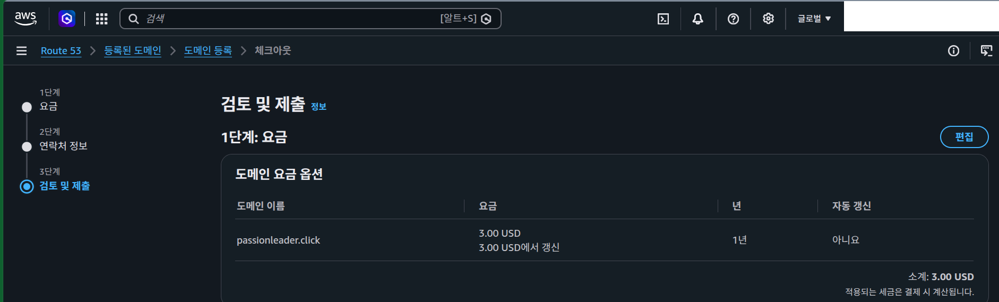

사용자가 할 것 (콘솔, 순서대로)

① 도메인 준비: 위처럼 하나 삼.

② SES → Identities → Create identity → Domain (리전 ap-southeast-2 Sydney, 콘솔 오른쪽 위에서 확인)

- Easy DKIM, RSA 2048. Route 53 도메인이면 "Publish DNS records to Route 53" 체크 → 자동.
- 다른 곳 도메인이면 SES가 보여 주는 CNAME 3개(DKIM)를 그 DNS에 넣음.
- DMARC TXT 하나 추가(받는 쪽 신뢰도↑): 이름 `_dmarc.<도메인>`, 값 `v=DMARC1; p=none;`
- 상태가 Verified가 될 때까지 기다림(몇 분~몇 시간).
- 발신 주소는 `no-reply@<도메인>`으로 쓸 예정(이 주소로 따로 받을 메일함은 필요 없음).

③ 샌드박스에서 테스트할 받는 주소 인증: Identities → Create identity → Email address → 내 ANU 메일 → 받은 메일의 링크 클릭. 승인 전에도 이 주소로는 보낼 수 있어서 개발·테스트 가능. (`qa_` 테스트용으로 개인 메일도 하나 더 인증해 두면 편함.)

④ Production access 신청: SES → Account dashboard → Request production access

- Mail type: Transactional

- Website URL: `https://comp4020-final-passionleader.fly.dev`

⑤ 반송·스팸 신고 처리: Account dashboard → Suppression list: Bounces and Complaints 켬(계정 단위, 따로 서버 코드 없이도 같은 주소로 계속 보내는 걸 막음). 반송률이 높으면 SES가 계정을 멈추니 꼭 켬.

⑥ IAM: 기존 서버 사용자(`campus-fly-server`)에 정책 추가(새 사용자·새 키 안 만듦)

```json
{
  "Version": "2012-10-17",
  "Statement": [{
    "Effect": "Allow",
    "Action": ["ses:SendEmail"],
    "Resource": "arn:aws:ses:ap-southeast-2:<계정번호>:identity/<도메인>",
    "Condition": { "StringEquals": { "ses:FromAddress": "no-reply@<도메인>" } }
  }]
}
```

- 샌드박스 동안 ③의 받는 주소로 테스트하려면 그 주소 identity도 Resource에 있어야 할 수 있음 → 처음엔 `arn:aws:ses:ap-southeast-2:<계정번호>:identity/*`로 두고 승인 뒤 좁혀도 됨.
- 다 되면 Claude에게 알려 줄 것: 도메인 이름, 발신 주소, Verified 여부, production access 승인 여부. (계정 번호·키는 채팅에 쓰지 않음.)

Claude가 할 것 (38번 때, 참고용)

- Fly secret 하나 추가: `SES_FROM=no-reply@<도메인>`(키·리전은 S3와 같은 것 그대로). 로컬은 저장소 밖 env 파일에 같은 줄.
- 서버: `@aws-sdk/client-sesv2`로 인증번호·비밀번호 재설정 메일. 메일이 안 가면 S3처럼 `MAIL-…` 오류 코드. 인증번호 10분 만료·시도 횟수 제한·재전송 1분 간격(38번 메모).
- 테스트: spec은 가짜 발신기(운영에서 절대 안 켬, `GAME_TEST_HOOKS`처럼). 실제 발송은 ③에서 인증한 주소로만 확인.
- README "What the app keeps about you"에 메일 주소 보관, 관리자 로그엔 메일 주소 안 남김.

확인할 것

- 승인 전: 샌드박스는 하루 200통, 초당 1통, 인증된 받는 주소만.
- ANU 메일이 스팸함으로 보낼 수 있음 → 가입 화면에 "Check your junk folder" 안내.
- AWS Budgets 알림(1번)이 켜져 있는지.

### 4. EC2: 음성 채팅(31번) 중계 서버 ← 맨 마지막

* 용도 두 가지를 한 대로:
   a. TURN (팀 회의룸 P2P 음성이 막힌 학교·회사 망에서도 되게 중계)
   b. SFU (맵 전체 음성: 서버가 음성을 모아 나눠 줌)
  → LiveKit 서버 하나가 둘 다 함(TURN 내장). 직접 짜는 것보다 안정적. (대안: mediasoup + coturn)
  
  - AMI(OS): Ubuntu Server 24.04 LTS (64-bit Arm)
  - 인스턴스: t4g.small (Arm). LiveKit은 ARM 지원. 그때 AMI도 arm64로
  - 디스크: gp3 20 GB
  - Elastic IP 1개 (주소가 바뀌지 않게)
  - 보안 그룹 (들어오는 것만):
     TCP 22 내 IP만 (또는 22 닫고 SSM Session Manager로 접속, 이게 더 안전)
     TCP 443 0.0.0.0/0 (LiveKit 신호 + TURN/TLS)
     TCP 7881 0.0.0.0/0 (WebRTC TCP 대체 경로)
     UDP 3478 0.0.0.0/0 (TURN/UDP)
     UDP 50000-60000 0.0.0.0/0 (미디어)
  - 도메인: WSS/TLS 인증서 때문에 이름이 필요. 싼 도메인 하나 또는 Route 53 호스팅 영역 추가함. A 레코드 추가 (voice.passionleader.click, turn.passionleader.click)
    (예: voice.<내도메인>). LiveKit이 Let's Encrypt 인증서를 자동으로 받음.
  - 키: LiveKit API key/secret → Fly secrets(LIVEKIT_URL, LIVEKIT_API_KEY, LIVEKIT_API_SECRET).
    Fly 서버가 "이 사람은 이 방에 들어갈 수 있다"는 토큰을 발급(최대 6명, 상담룸 초대 규칙 그대로).
  - 비용(Sydney, 대략): t3.small 기준 ≈ $19/월(t4g.small은 조금 더 쌈) + Elastic IP ≈ $3.6/월 + 디스크 ≈ $2/월
    - 나가는 트래픽 ≈ $0.11/GB → 합계 약 $25~30/월 → $100 크레딧으로 3달쯤.
      안 쓸 때는 인스턴스를 Stop 해두면 디스크·IP 값만 나감.

### 5. Bedrock: AI 캠퍼스 안내원(체크리스트 56번)의 모델, 월 $10 한도   ← (10/25 Claude 작성) Anthropic 키 대신 쓸 경우

> 써도 되나? 됨. 코스 담당 강사가 Ed 공지(A3 글)에서 외부 AI 서비스는 코스의 'off piste' 정책 안에서 허용, 조건은 ① 채점 기간(11/9 뒤 약 2주)에도 돈이 남아 있을 것 ② 떨어지면 분명한 안내(이미 `NPC-CREDIT` 문구 있음) ③ 연락 오면 바로 답할 것. Fly secret 보안도 강사 설명대로 다른 학생은 못 봄(강사진은 신뢰 범위 안). Bedrock은 S3·SES와 같은 AWS 계정·같은 IAM 사용자라 키를 새로 안 만들어도 됨 + AWS 크레딧을 쓸 수 있을 수 있음(아래 ⚠️).
> 
> Anthropic 직접 키 vs Bedrock: 둘 다 됨. Bedrock 장점 = 키 관리가 S3와 한 곳, 크레딧. 단점 = AWS엔 "월 $10에서 딱 멈춤" 같은 하드 한도가 없음 → 아래 ④·⑤ 두 겹으로 막음.

모델 고르기 (싼 것)

| 모델                            | 대략 값 (100만 토큰당 입력/출력) | 질문 1개 비용* | $10로    | 메모                                           |
| ----------------------------- | --------------------- | --------- | ------- | -------------------------------------------- |
| Amazon Nova Micro             | 약 $0.04 / $0.14       | 약 $0.0001 | 약 10만 개 | 제일 쌈, 짧은 안내엔 충분할 수 있음. AWS 자체 모델이라 크레딧 적용 쉬움 |
| Amazon Nova Lite              | 약 $0.06 / $0.24       | 약 $0.0001 | 약 7만 개  | Micro보다 조금 똑똑                                |
| Claude Haiku (Bedrock에 있는 최신) | 약 $1 / $5             | 약 $0.002  | 약 5천 개  | 답 품질 제일 좋음. 지금 코드의 프롬프트 그대로                  |

\* 질문 1개 ≈ 입력 600토큰(안내원 설명 포함) + 출력 300토큰으로 계산. 값은 대략이고 리전·시점마다 다르니 콘솔의 Pricing에서 꼭 확인. 추천: Claude Haiku로 시작, 하루 전체 한도를 150개로 낮춤(한 달 최대 약 4,500개 ≈ $9). 품질이 괜찮으면 Nova Micro로 바꿔 한도를 늘려도 됨(코드에서 모델 ID만 바꿈).

사용자가 할 것 (콘솔, 순서대로, 리전 ap-southeast-2 Sydney)

① 모델 접근 켜기: Bedrock → Model catalog에서 위 모델을 찾아 연다. Sydney에서 바로 안 보이면 이름에 `au.`나 `apac.`가 붙은 cross-region inference profile로 나옴(그 ID를 씀). Anthropic 모델은 처음 쓸 때 사용 목적 양식(회사명 칸엔 "ANU student project", 용도엔 "Answering campus questions in a student course project")을 한 번 냄. 승인은 보통 바로~몇 분. → Free Tier를 쓰고 있어서 Nova 2 Lite로 결정

② Playground에서 한 번 시험: Chat playground에서 그 모델로 "When is Chifley Library open?" 보내 보고 답이 오는지. 여기서 쓴 모델 ID(또는 inference profile ID)를 메모 → Claude에게 알려 줌(비밀 아님).

③ IAM: 기존 `campus-fly-server`에 정책 추가(새 사용자·새 키 안 만듦). 그 모델 하나만 부를 수 있게:

- inference profile을 쓰면 요청이 다른 호주 리전으로 갈 수 있어서 foundation-model 쪽 리전은 `*`로 둠. 바로 된 모델 ID면 두 번째 줄은 지워도 됨.
- 정책 이름 예: `campus-bedrock-npc`. 계정번호·키는 채팅에 쓰지 않음.

④ 돈 막기 1 — 알림: Billing → Budgets → Create budget → Cost budget, 월 $10, 필터 Service = Amazon Bedrock(Claude 모델은 Marketplace로 잡힐 수 있으니 필터에 "AWS Marketplace"도 같이 넣거나, 필터 없이 계정 전체로 하나 더). 알림: 실제 50%·80%·100%, 예상(Forecasted) 100%에 메일.

### 돈 나갈만한 것들

- S3, SES, Bedrock, EC2, Elastic IP
- Route 53 호스팅 영역 (영역 하나당 월 고정요금 + DNS 조회요금)
- 도메인 처음 등록 비용 (자동 갱신 끔, 2027년 10월쯤 만기)

---

## 프로젝트 끝나고 할 것

AWS처리 

* 제거 시
  
  * 위에서 생성한 것들 제거

* 백업서버 생성 시
  
  * EC2 하나 띄우기 (프로젝트 다 끝나면 백업 진행)
  
  * 내가 띄운 EC2 해당 서버는 2027년 4월에 꺼지도록 세팅

---

# crit 8 (proof of life)

## The idea in one sentence

위 최종 프로젝트에 구현할 것의 프로토 타입.

이걸 다 구현하려면 시간이 모자라니 일단 이런 로직?

접속 시 창이 뜸 > 사용자 이름 적기 (알파벳과 밑줄만 허용, 최대 8글자). 이름은 중복이 불가능하다

접속하기 버튼 누르면 화장실 3d맵에 입장 (무료 변기 3d 에셋 사용)

스페이스 바 누르면 사용자가 있던 위치에 똥이 생긴다. 똥에 가까이 가면 똥 싼 사용자 이름이 2d로 표시된다. (DB 로 똥의 좌표 및 똥 주인 이름 저장 필요)

이번에는 프로토 타입이니까, 실시간 통신은 구현하지 않는다. 똥을 싸는 순간 DB에 기록하고 맵을 불러올 때 DB에서 기존의 똥의 위치를 불러온다

모바일 지원 여부? > 가능하면 지원한다. 따라서 가상 키패드(십자키)와 똥싸기 버튼은 구현해야 한다.

BGM지원 - 우측 상단에 '스피커 버튼' 추가해 주고, 이 스피커 버튼을 누르기 전까지 평화로운 브금이 나온다. 또한 스페이스 누르면 방귀소리가 난다. 우측 상단 스피커 버튼은 음소거 버튼임

## Who is it for

온라인에서 흔적을 남기고 싶은 모든 사람에게 추천하는 앱이다. 특히 친한 친구들끼리 접속하거나, 학급 동료들의 조별과제 등 어색한 사람들이 친해지고 싶을 때 똥을 싸놓고, 나중에 와서 접속하면 추억을 되돌릴 수 있다. "너 나 보자마자 똥 쌌잖아". "우리 영원을 똥에 새겼는데 기억하니?" "너 똥에 내 똥을 둘 수 있어서 기뻤어" (실제로 사이트에 적으면 좋겠음)

## The ONE core thing a stranger does

접속하자마자 창이 뜨고, 이름을 쓰고 입장하기를 누르면 화장실에 입장한다. 스페이스바로 똥을 남길 수 있다. 똥의 유효기간은 없다. (나중에 똥 치우기 기능 구현 예정)

똥은 여러번 쌀 수 있으나, 화장실에 남는 것은 가장 마지막에 싼 똥의 위치이다. 따라서 똥을 새로 쌀 때마다 기존 똥의 행을 업데이트 하는 식으로 진행하면 될 것 같다. (한사람당 똥 범벅이 되도록 하면 안됨)

## The trace they find when they come back

다시 접속했을 때 남아 있는 것: 똥의 위치, 똥에 가까이 갔을 때 똥의 주인의 이름이 표기됨

## Out of scope for crit 8

실시간 통신 및 화장실 디자인은 하지 않는다(화장실은 누리끼리한 색). 광원은 신경쓰지 않는다(이번에는 간단하게 공간의 광원을 균일하게 밝게 만든다). 인벤토리 및 채팅창도 만들지 않는다. 똥 줍기나 치우기는 이번에 만들지 않는다. 캐릭터 커스터마이징도 하지 않는다(일단 3인칭 시점이니 흰색 사람모양 찰흙 텍스쳐? 가장 기본적인 형체)

## Stack

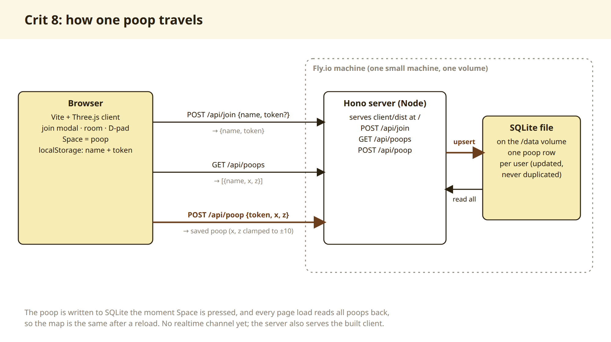

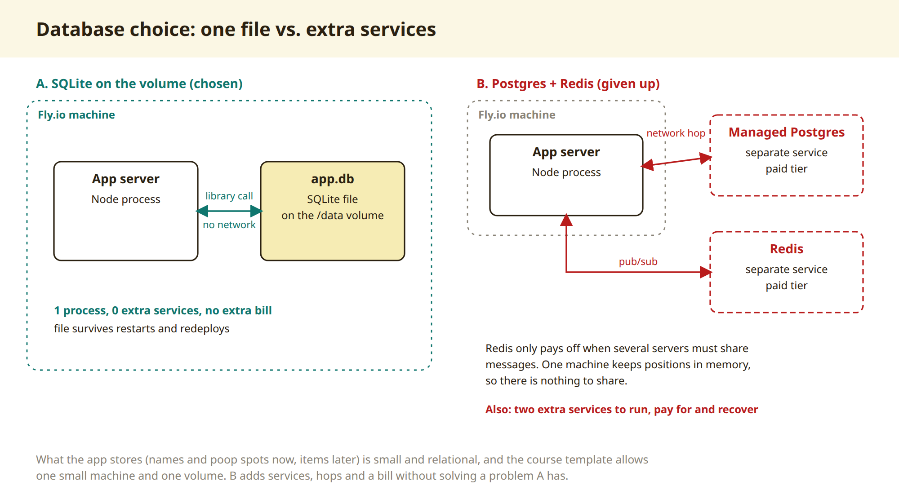

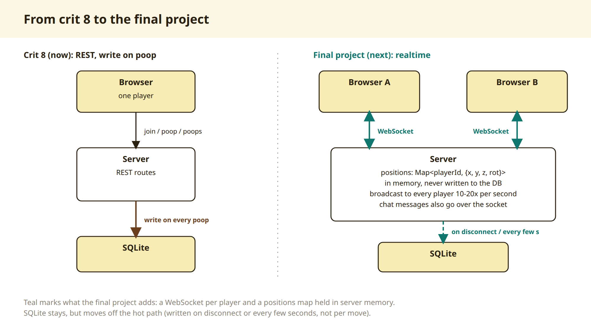

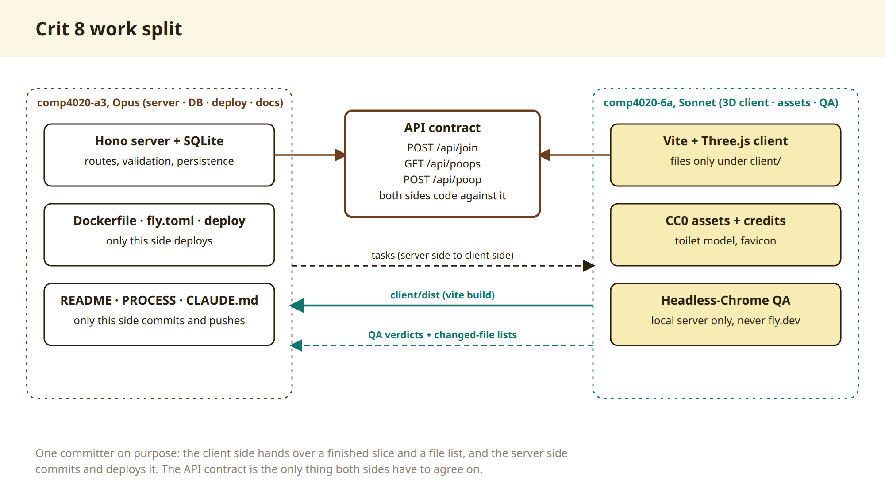

## What good means for this app (v1)

- 똥이라는 유치하고 어리고 더러운 주제로, 어색한 사람들이 친해질 수 있다.
- 3d 공간이라는 입체적인 주제로, 마치 가상의 세계에 들어온 듯한 효과를 준다.
- 아직은 프로토타입이지만, 똥 이라는 방명록에 나의 다짐, 영원한 사랑, 할일 목록 등을 남겨 평생 기억에 남길 수 있다.
- 똥이 마렵지 않아도 똥을 생성할 수 있다
- 키보드 만으로 생리적인 쾌감을 경험할 수 있다.

## What I read / looked at while deciding

* Good이라는 것은 무엇일까
  * 좋은 게임이란? [ArtStation - A practical guide to Game Design](https://www.artstation.com/blogs/andrewdowell/PQaWj/a-practical-guide-to-game-design)
    * 좋은 게임은 플레이어가 선택하고, 성장하고, 실패하고, 다시 도전하고 싶게 만드는 시스템과 이야기를 가진다고 언급. 하지만 나는 이 글을 읽고 곧 게임이 아니라 소통할 공간을 원한다는 것을 깨달음
  * 좋은 커뮤니케이션이란? [Effective communication | Comcare](https://www.comcare.gov.au/safe-healthy-work/healthy-workplace/work-design/better-practice-guides/effective-communication)
    * 좋은 커뮤니케이션을 위한 조건을 설명한 페이지지만, 온라인에서도 커뮤니케이션은 유효하다.
      - 명확한 목적 전달 → 온라인에서는 정보 손실이 더 크기 때문에 필수
      - 적절한 채널 선택 → 가상 공간은 채널이 더 다양함
      - 공감적 듣기 → 비언어적 신호가 줄어드는 환경에서 더욱 중요
      - 오해의 빠른 해결 → 텍스트 기반 소통은 오해가 더 쉽게 발생
- 레퍼런싱
  - [https://hop.earth/](https://hop.earth/) -> 실시간 게임 월드 구현
  - [https://learn.framevr.io/](https://learn.framevr.io/) -> 온라인 화상 회의. 궁극적으로 내 목표와 가장 가까운 모습 (파이널 프로젝트에서 진행)

## Process.md (Crit8)

- 왜 이 스택을 골랐을까?
  - 우선 3D 월드는 독창성과 시선을 끄는 면에서 최고이다. 그래서 WebGL을 골랐다. Three.js와 Babylon.js 중 어떤 것을 고를지는 더 생각해 봐야겠다.
  - 또한 싼 똥의 위치와 유저네임을 기록하기 위해 SQLite를 사용했다. 지금 쓰는 fly.dev 티어에서 업그레이드 없이 쓸 수 있다. 라이브러리 하나로 파일 하나에 저장되고 별도의 DB 서버가 필요 없어서 딱이다!
  - 나중에 final project에서는 실제 게임처럼 WebSocket 기반 통신으로 실시간 위치 공유와 채팅도 지원하면 좋을 것 같다.
  - Colyseus (room 기반 상태 동기화, 직접 구현보다 서버 코드량이 줄어듦)
- 포기한 스택 (위 "Database choice" 그림 참고)
  - Postgres + Redis: Fly.dev에서 관리형으로 쓰려면 유료다. 나는 지원받은 크레딧으로 무료로 운영하는 것을 목표로 하고 있다. 게다가 머신 하나에 프로세스 두 개를 같이 띄우는 것도 걱정된다. 머신 하나를 서버로 쓸 거라 굳이 Redis도 필요 없다. 캐싱 자체가 필요 없으니까.
  - NoSQL도 고려했으나, 별도의 서버 프로세스를 띄워야 하므로 머신 하나, volume 하나 구조에는 맞지 않았다.

--------------

# Crit 9 (All at once)

* Crit 9 범위: 1~9번까지 진행 (마감 10/14 수 07:00)
  
  * 진행: 1~9번 (계정 → 공간 구조 → 문 이동 → 맵 3개 → 채팅 → Q 메뉴 → 스티키 노트)
  
  * 시간이 남으면: 10번(서버 로그)을 미리 시작. 어차피 crit 10 과제라서 손해가 없음.
- 크릿 필수인데 기능 목록에 없는 것 (코드보다 먼저 챙길 것):
  
  - 결정 기록(ADR) 1개: 여러 명이 동시에 쓸 때의 동작 하나. 후보: "채팅은 1분 뒤 사라지고 스티키 노트는 남는다", "같은 공간 사람끼리만 보인다", "재접속하면 마지막 위치에서 시작"
  - `reflections/crit-9.md` (한국어 초안 주면 영어로 옮김)
  - PROCESS.md 다시 쓰기 (주차마다 새로 씀)
  - README의 "good" 정의 다시 쓰기: 똥 → ANU 공간/스티키 노트로 바뀌는 만큼 내가 직접 고쳐야 함

- 주의:
  
  - 건물 사진과 위성지도는 모델링할 때 참고용으로만 쓰고, 앱이나 공개 저장소에 그대로 넣지 않음
  - ANU 로고나 공식 디자인은 흉내 내지 않음
  - 똥 → 스티키 노트로 바꾸면 crit 8 기능이 바뀌는 것이니, 커밋 메시지와 PROCESS에 "왜 바꿨는지"를 남김

### 맵 디자인

* Student Hub + COMP8020 Classroom + 캠퍼스 외부 일부(사진 첨부) 
  
  * Marie Reay Teaching Centre (Building 155): 
  
  * BKSS - Brian Kenyon Student Space: Student Hub 로 들어가는 문이 있음
  
  * 캠퍼스 외부 (사진은 참고용으로만 쓰고 저장소에는 올리지 않음)

* 캠퍼스 외부
  
  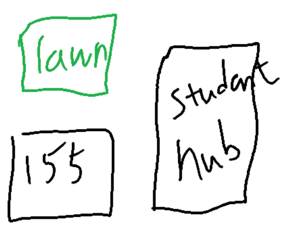
  
  * 웹 검색으로 해당 건물의 모습을 직접 가져와 모델링 한다 (나는 ANU 학생이라 써도 돼 괜찮아.)
  
  * 필요시 OpenStreetMap 건물 윤곽(출처 표기)을 참고한다
  
  * 155 쪽에 강의실로 들어가는 문이 있음, Student Hub에 스튜던트 허브로 들어가는문이 있음

### 이번 주 서류작업

#### Reflection

무료 어셋과 Gemini. 무료 어셋 덕분에 ANU 캠퍼스 맵의 일부와 바닥·벽 텍스처를 구현할 수 있었고, 특히 Gemini로 하늘 배경화면, 배경 음악 등을 생성할 수 있었다. 이번 주 작업을 하고 나니 '와, 이제 1인 게임 개발이 가능한 시대구나. 앞으로는 창의적인 아이디어가 많이 필요하겠다'는 생각이 들었다. 앞으로는 여러 인공지능을 적재적소에 잘 활용하는 개발자가 살아남게 될 것으로 보인다. (돌파구)

왜 똥에서 ANU로 방향을 전환했을까? 우선 똥은 모르는 사람끼리 친해지기 좋은 소재이다. 다만 단순히 똥만 싸는 것을 넘어서, 실제로 활용 가치가 있는 프로젝트를 만들고 싶었다. 그래서 똥보다는 실제로 인터랙션이 가능하고, 실제 학교에서 쓸 가치가 있는 프로젝트를 원했기에 방향을 전환했다. 또한 나는 '독창성'을 원했기에 내 아이디어가 다른 학생들의 것과 겹치는지 물어보았고, 독창성이 확보됐다고 판단하자마자 프로젝트에 착수했다. 실제로 Student Hub에서도 학생과 교수 사이에 비공식적인 교류가 없다는 점을 지적하는데(Student Hub 쪽에서 직접 들은 이야기), 나중에 이 프로젝트가 빛을 봐서 실제 Student Hub에서 쓰일 수 있는 알찬 프로젝트가 되었으면 한다. (개발자로서 어떤 사람이 되고 싶나)

사실 Opus 모델을 쓸 수 있다는 건 지난주에야 깨달았다. 이번 주에는 docs/roles.md에 역할을 나눠 적고 그대로 업무를 진행했고, 그 결과 업무 효율과 크레딧 절약을 모두 달성할 수 있었다. 단순 업무에는 Sonnet Medium, 정교한 추론에는 Opus High를 써서 역할을 분배했다.

#### Process

우선 내가 진행한 방법은 plan_draft_for_final.md 파일 하나에서 계획, 스펙, 스프린트 관리를 모두 하는 것이다. 이 마크다운 파일은 거의 손으로 쓴 아이디어 노트이자 개발자 노트나 다름없다. 아이디어와 스펙, 리플렉션, 하네스 규칙, 세션별 역할(Role) 등을 모두 여기에 쓰고, Claude에게 이를 plan.md, CLAUDE.md 등에 반영해 달라고 요청했다. 구현 중 새로운 아이디어가 생길 때마다 이 개발 노트에 꾸준히 기록했다. (이 개발 노트는 커밋하지 않는, 순수한 나만의 노트이다)

실시간 방식을 왜 WebSocket으로 구현했을까? 기존 게시판이나 아케이드 게임처럼 고정된 상태를 동기식으로 주고받는 것과 달리, 내 앱은 상대 유저의 위치가 실시간으로 표시되고 서로 인터랙션할 수 있어야 한다. 그래서 캐릭터가 움직였을 때에만 일정 간격으로 서버에 위치를 보내고, 서버의 ack(응답)를 기다리지 않는 이벤트 기반의 비동기 방식인 WebSocket을 택했다. 소켓 통신은 온라인 RPG 게임에서 흔히 쓰는 방식이고, 게임 회사 데브옵스 출신인 나는 이 방식을 적용해 보고 싶었다. 물론 DB 쪽 처리(노트 저장, 접속 종료 시 위치 저장 등)는 동기식이다. 즉 행동 하나하나가 모두 DB에 저장되지는 않는다는 말이다.

#### Readme

뭐가 좋은 공간일까?

처리 유창성 이론(Processing Fluency Theory; Reber, Schwarz, & Winkielman, 2004)에 따르면, 인간의 뇌는 이미 친숙한 시각적·공간적 정보(Mental Map)를 접할 때 정보 처리에 드는 인지적 노력을 최소화하며, 이러한 유창한 처리 과정은 유저에게 심리적 안전감을 주고 긍정적 감정(Positive Affect)을 불러일으킨다.

또한 인지 부하 이론(Cognitive Load Theory; Sweller, 1988)의 관점에서 보면, 예측 가능하고 익숙한 캠퍼스 구조는 가상 환경 자체를 탐색하고 적응하는 데 드는 '외재적 인지 부하(Extraneous Cognitive Load)'를 비약적으로 낮춰 준다. 이렇게 아낀 인지 자원은 가상 공간 안에서의 복잡한 과제 수행, 깊은 사고, 그리고 창의적인 협업 활동에 집중하는 데 쓸 수 있다. Cyber ANU는 이러한 인지 심리학적 메커니즘을 바탕으로, 학생들이 거부감 없이 가상 캠퍼스에 몰입하는 것을 지향하였다.

물리적인 장벽을 완전히 없애 접근성을 높이고, 날씨나 물리적인 제약에서 벗어난 새로운 형태의 접근 가능한(accessible) 커뮤니티 공간을 지향하였다. 또 매일 업무할 때 보는 2D 화면이 아니라, 누구라도 편히 쉴 수 있는 마치 게임 같은 공간을 제공하고 싶었다. 즉 학생들은 편하게 가상 캠퍼스에 접속해 휴식하고, 부담 없이 사교 활동을 할 수 있다.

평화로운 BGM과 게임 같은 어셋 덕분에 낯가림이 심한 사람도 소셜 활동을 할 수 있다. 원하면 스티키 노트(Sticky Note)를 붙여 내 흔적을 남기고, 학급 친구들이 댓글을 달아 소통에 재미를 더한다. 같이 춤도 출 수 있다.

누가 사용하는가?

주 사용 대상은 ANU와 관련된 모든 사람이다. 비록 지금은 학생 간의 커뮤니케이션 위주로 구현되어 있지만, 앞으로는 스태프와 교수진이 학생들과 비공식적으로 편하게 소통할 수 있는 공간을 만들고자 한다. 실시간 텍스트 채팅과 모션으로 함께 어울릴 수도 있고, 스티키 노트로 흔적을 남길 수도 있다. ANU 학생, 스태프, 교수들은 실제 캠퍼스의 친숙한 모습으로 구현된 가상 환경에서 편안함을 느낄 수 있다.

#### ADR


DB로 Redis + Postgres를 고려했으나, 지금처럼 저사양 노드 하나로 구현하기에는 문제가 있다. 게다가 유료이고, 노드가 하나뿐이라 Redis 캐싱은 별 의미가 없어서 부하가 적은 SQLite를 적용했다. 또한 WebSocket은 처음부터 실시간 통신을 염두에 두고 만들었기에 큰 고민 없이 결정할 수 있었다. 다만 여러 명이 동시에 쓸 때는 저사양 fly.dev 노드 하나로는 모자랄 것으로 보인다. 만약 내 서비스가 ANU에서 정식으로 채택된다면, 두말없이 노드를 여러 개 두고 Postgres + Redis 캐싱을 적용할 것이다. 장애 대응은 어떻게 해야 할까? 내 서버는 단일(dedicated) 서버로 동작한다. 따라서 로드밸런싱을 적용하기보다는 콜드 스탠바이 방식으로, DB만 주기적으로 백업해 두었다가 리전이 통째로 다운되면 다른 리전에 서버를 새로 만들고 DB 스냅샷으로 복구해서 다시 돌리는 방식으로 진행할 예정이다. 사실 fly.dev 서버 사양이 많이 낮아서 아쉬웠다. 파일 공유 기능과 실시간 음성 채팅도 구현해 보고 싶었고, min_machines_running = 1로 설정해서 머신이 유휴 상태 없이 언제나 바로 연결되도록 해 보고 싶었는데 좌절되었다.

---

# Crit 10 (Fly by instruments)

## 이번주 진행한 것

이번 주 진행한 것 (번호 = `Integreted_checklist.md`, 자세한 내용·커밋은 그 파일)

- 마감: 10/21(수) 07:00, 코드 마감 10/20(화) 18:00. crit 11은 없음 → crit 10이 마지막 크릿, 다음은 Final Project(11/9(월) 12:00).
- crit 10 필수 (채점 대상: 두 사람 구분 · 권한은 서버에서 · 로그): ✅ 10 서버 로그 + 관리자 7일 로그 · ✅ 11a 강의실 열기/닫기(관리자만) · ✅ 11c 강의실 게시판(공지는 관리자만) · ✅ 25 인앱 창/새 탭 · ✅ 21·6a·26a·30 상담룸·팀룸(6명, 초대제)
- 당겨서 한 것: ✅ 4a·4b 배경·동쪽 길 · ✅ 29 강아지(+짖는 소리) · ✅ 28 Sketch & Guess · ✅ 26 도서관 내부 · ✅ 13·13a 소리·효과음 · ✅ 14 캐릭터 꾸미기 · ✅ 15a–15i 그래픽·에셋 · ✅ 23 앉기
- 사용자 요청으로 더 한 것: ✅ A1 S3 파일 첨부(원래 파이널) · ✅ 12·27 Hub 게시판·연구자 찾기 · ✅ 12a 잔디밭 게시판 · ✅ 32 접속자 수 · ✅ 33 일부(Report someone + 관리자 제한) · ✅ 글·댓글 수정, 마크다운 · ✅ Lab Coffee·카페 목록 · ✅ 회의룸 툴바·마지막 사람 경고 · ✅ Hub·도서관 재배치 · ✅ 치플리 외벽·카메라 · ✅ 폰 버그(볼륨·새 탭·확대) · ✅ LICENSE · ✅ 이름 변경 "ANU Crossing (Unofficial)" · ✅ 자체 서버 가이드
- 이번 주에 안 한 것 (파이널로): 16·17 우편·1:1, 1a·1c·38 인증·스태프, 31 음성, 34 카메라 회전, 35 셰이더, 36·37·39
- 남은 것: 결정 기록 002 · `reflections/crit-10.md` · `PROCESS.md` (직접 작성, 위 "## 문서화"의 "(crit 10에 적용)" 재료) → 리허설(qa_bot 두 개 + 로그만 보고 설명) → `crit-10` 태그 · seong-fin

### Process.md 작성 한국어 초안 + 결정 기록

이번주 Process.md에 넣을 스크린샷과 중요한 내용

- IP, 행동(스티키 노트 내용), 아이디 > 관리자 PC에서 관리자 계정으로 조회 가능하게 구현하였다. 악의적인 행동은 모니터링 후 유저 차단이 가능하다. IP 등 민감정보를 포함하고 있어 7일만 서버에 보관한다
  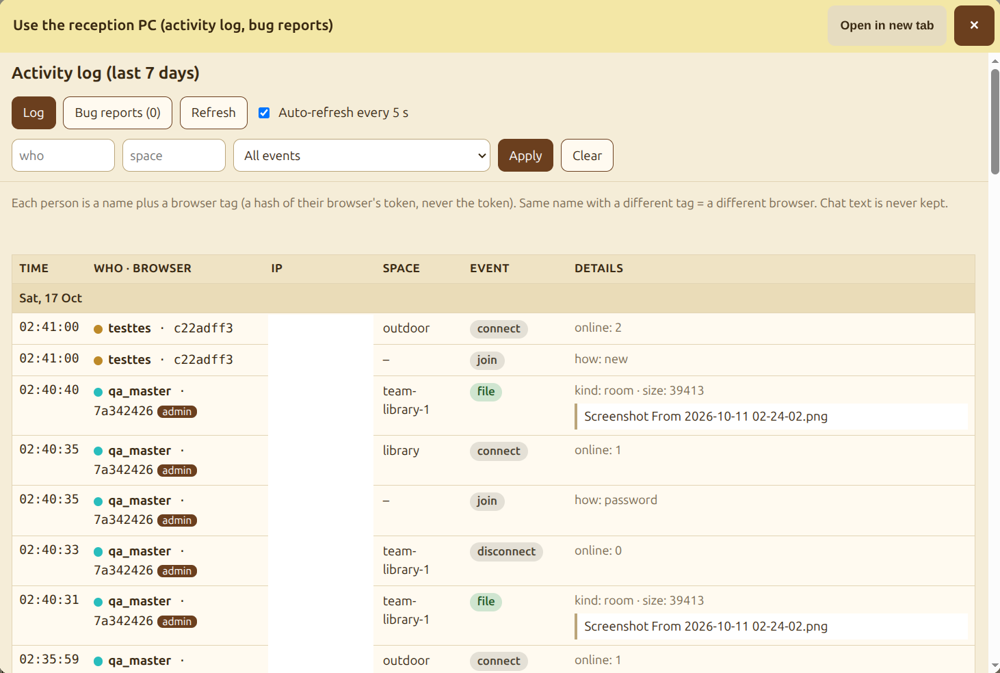

- 유저는 버그를 신고할 수 있으며, 첨부파일을 첨부할 수 있다. 마찬가지로 관리자 페이지에서 이를 확인할 수 있다. 이는 S3에 저장된다
  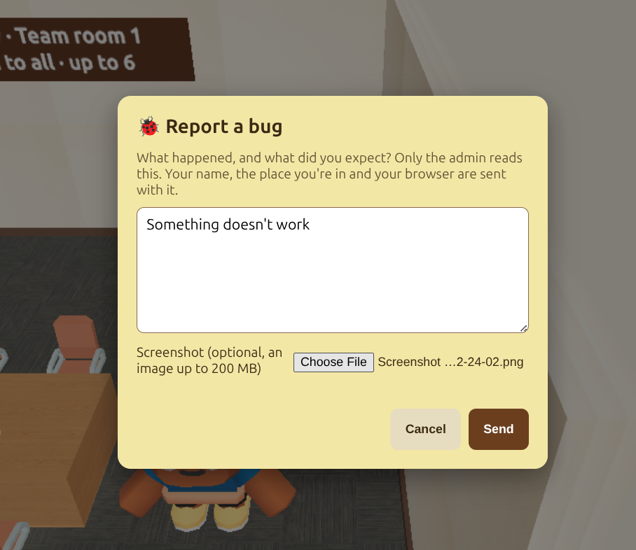

- 마찬가지로 유저는 악성 유저를 신고할 수 있다. 욕설 등을 신고하는 등 유용히 쓰일 예정이다.
  
  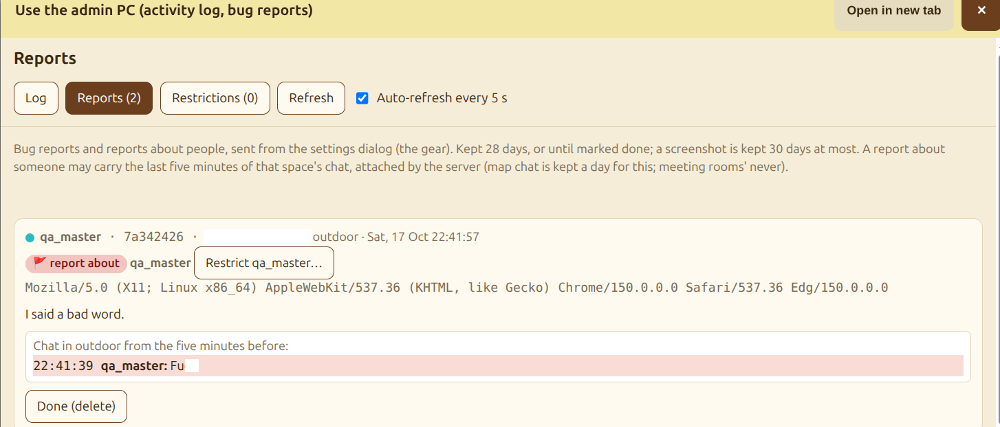

- 현재 제한적인 스펙을 가진 서버의 용량을 줄이기 위해 채팅의 첨부파일, 버그 레포트의 첨부 파일, 게시글의 첨부파일은 AWS의 S3로 저장된다. IAM권한을 따로 발급받아 정말 필요한 읽기, 쓰기, 삭제 권한만 부여하였다. S3를 선택한 이유는 저렴한 비용으로 첨부 파일을 대응하기 위해 선택하였고, 쓰기/읽기/삭제 권한을 가진 IAM권한을 직접 생성하여 보안을 유지하도록 애썼다.
  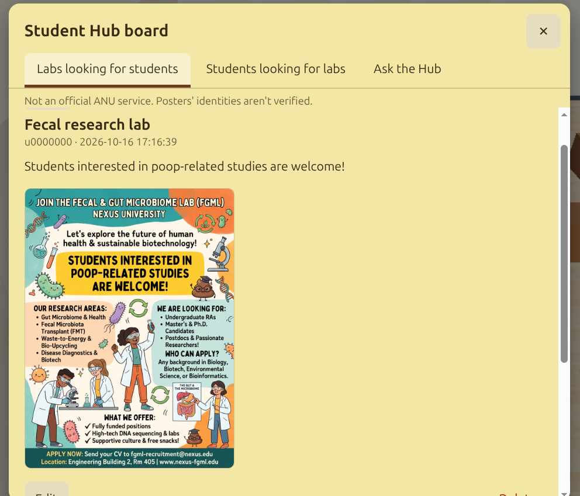
* 다음은 AWS아키텍쳐까지 포함된 현재 구현된 다이어그램이다.  버킷 자체의 lifecycle을 30일로 세팅해 주었으며, 이와 별도로 서버 측에서도 만료되었다고 판단하면 delete 작업을 행한다.
  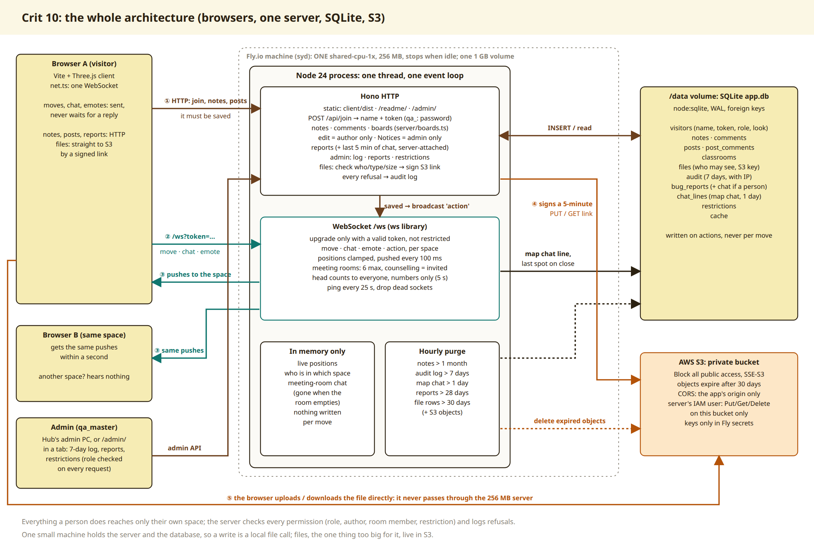

* 그 외에 '커뮤니케이션 공간'을 완성 시키기 위해 Chifley Library, 회의룸을 추가하였고, EdStem 역할을 진행할 수 있는  게시판을 추가하였다. 팀 회의룸과 counselling room에서는 파일을 주고받고 팀 내부(최대 6명)과 함께 협업을 진행할 수 있다.

* 또한 코스워크 학생을 위해 연구실 찾기, 교수들을 위한 학생 찾기 기능의 모집 게시판도 개설하였고, 학생-스태프-교수진 간의 공식적인 그리고 비 공식적인 커뮤니케이션이 가능한 공간으로 탈바꿈 하였다

* 신규 텍스쳐 건물, 신규 BGM을 추가하므로, 유저가 '이 사이버 공간(메타버스)이 제대로 된 공간이구나' 하고 몰입할 수 있도록 매우 신경을 쓰고 노력했다. 텍스쳐랑 BGM은 구글 제미나이를 통해 생성하였다. 

* "어떻게 지시하고(directed) 근거를 주고(grounded) 고쳤나(corrected)"
  
  - 신고가 버그로 뜸 → 대상 이름 규칙 때문에 `qa_master`가 버려짐 → 고침 [919fbc5]. 일단 내가 직접 QA를 뛰면서 발견한 내용을 공유했고, AI가 원인을 설명함. 고치도록 유도함
  - "채팅은 절대 안 남김"(001)이 신고와 충돌 → 맵 채팅만 하루로 001을 개정 [919fbc5]
  - 폰에서 직접 찾은 버그(볼륨·새 탭·확대) [276292a](https://github.com/comp4020-agentic-coding-studio/comp4020-final-passionleader/commit/276292a) → 초안 Reflection "UX는 AI가 모른다" 따라서 유저가 할 수 있는 기이한 행동들은 QA로 돌릴 수 없으니 이는 어쩔 수 없이 사람이 직접 QA가 필요하다는 뜻이다.

* (이미 추가한 내용 중 중요한 내용인데 누락된 것 같은 게 있으면  이 파일 / checklist 파일 참고해서 한두개 덧붙이기)

### 리허설

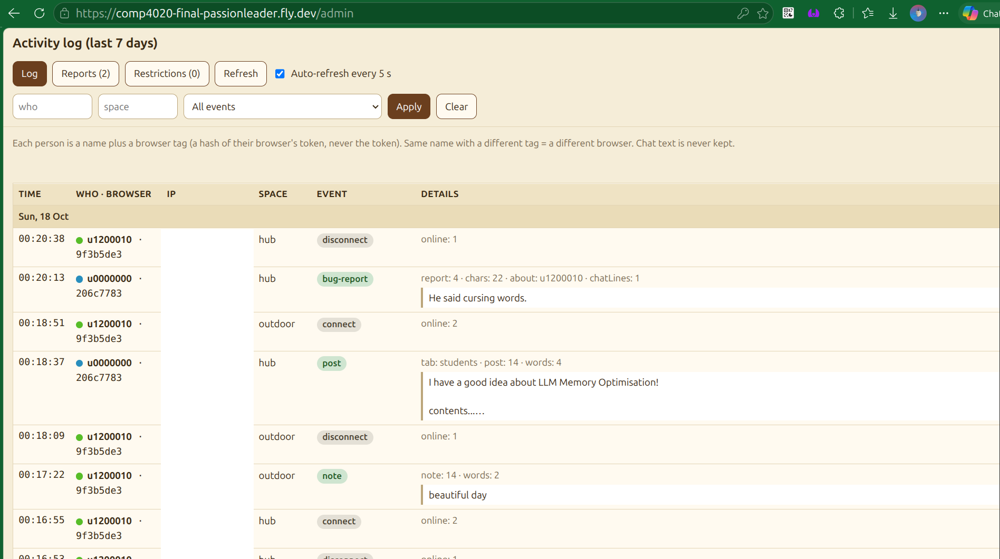

* u0000000 학생이 접속 후 u1200010 접속함

* u1200010 학생은 beautiful day라는 노트를 작성함

* u0000000 학생은 student hub 게시판의 student 탭에 좋은 LLM 연구 아이디어가 있다고 게시글 작성

* u0000000 학생은 이용자 신고 기능을 통해 누군가를 신고함 

* 참고로 여기서 이벤트명이 bug-report로 뜨는 것을 발견해서 `person-report`로 이벤트명 변경함

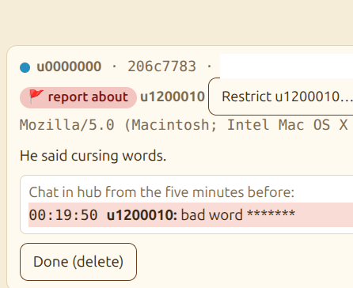

* u0000000 이 신고한 신고 대상은 u1200010이었음

### Readme.md 작성 한국어 초안

* 무엇이 좋은가?
  
  * 단순 게임을 넘어서 소통 가능한 공간을 만들고 싶었다. 
  
  * *Analyzing the Impact of Metaverse Technology on Social Development: A Field Study on Generation Z in the United Arab Emirates* [[링크](https://www.mdpi.com/2076-0760/13/9/446)] 에 따르면 메타버스 플랫폼 활용이 청년층의 사회적 기술(Social Skills) 향상, 인간관계 구축, 효과적인 소통을 촉진한다는 점을 입증한다.
  
  * 수줍은 학생의 경우 의사소통이 부담스러울 수도 있다. 이 ANU Crossing 을 통해서 비대면으로 키보드와 함께 모르는 사람을 탐색하고 네트워크를 형성할수 있는 계기가 되면 좋겠다
  
  * 또한 ANU에서 채택한 Student Hub와 EdSTEM의 기능을 같이 녹여들게 하고 싶었다. 학생은 관심있는 지도교수를 쉽게 찾고, 반대로 지도교수는 마음에 드는 학생을 찾아 연결을 형성할 수 있다.
  
  * A review of the metaverse and its implications for urban development(2026)에 따르면 메타버스가 시민 참여(Civic Engagement)를 높이고 도시 내 공간적 장벽을 대폭 낮춤으로써 소외 계층을 포함한 '포용적 경제 성장'과 '도시 이동성 개선'이라는 사회적 혜택을 제공할 수 있다고 주장한다.
    
    * 가상의 세계지만 실제같이 느낄 수 있도록 현실 세계의 지도와 건물 디자인을 반영하여 ANU학생들이 마음 편하게 접속해서 쉬고 소통할 수 있는 공간을 지향한다.
    
    * ANU의 캠퍼스는 꽤 넓어서, 예를 들어 Yukeembruk 부터 Cambri 까지 걸어가는데 15분 정도 걸린다. 일종의 커뮤니케이션의 장벽인 셈이다
    
    * ANU Crossing 메타버스는, 이러한 공간적인 장벽을 넘어서 집에서 키보드 딸깍만으로도 ANU커뮤니티에 접속할 수 있는 접근성을 제공한다

### Reflection 한국어 초안

- 아이디어는 언제 어디에서 좋은 아이디어가 떠오를 지 모른다. 나는 아이디어가 떠오를 때마다 메모해 두고, 추후 작업할 리스트로 남겨 두는 방향으로 진행했다

- UX는 인공지능이 모른다! 뭐가 불편하고 뭐가 편한지 이 관점을 잘 모름. 이건 인간의 경험으로만 수정하고 개선할 수 있는 영역이다!

- 배경음, 어셋 등에 특별히 신경을 많이 썼다. 다만 인공지능은 실제 현실이 어떻게 구현되었는지 알 지 못하여 직접 그림을 그리거나 사진을 찍어서 제공했어야 했다. 아무리 LLM이 뛰어나다고 해도 현실에 있는 데이터를 완벽히 옮기기는 부족하므로, 이와 관련 직무가 생길 수도 있다는 생각이 들었다.

- S3(구현 완료) 등 AWS 인프라를 사용하는 쪽으로 진행 하였는데, 이를 진행하면 느낀 점은, 인프라 스트럭쳐는 여전히 사람의 손이 필요하다는 것이다. 최소한 IAM권한을 주어서 필요한 권한만 서버 혹은 LLM에 부여해야 한다. 인공지능은 권한 관리를 알아서 진행해 주지 못하며, 설령 가능할 지라도 매우 리스크가 크다. 따라서 앞으로 권한 관련해서 개발자로써의 인간의 중요성이 더 커 질것으로 보인다. 나는 이와 관련하여 클라우드 권한 관리자로써의 커리어도 생각 중이다.

- 현재 Fly.dev 구현은 단일 서버에 하나의 프로세스로 DB, 백엔드가 모두  구성되어 있어 해킹이 취약할 것으로 보인다. 심지어 S3의 경우 하나의 버킷으로 채팅 첨부파일, 게시판 홍보 파일 등이 전부 공유되는 버킷이다. 현재 S3 접근용 IAM계정은 분리해서 서버에 제공해 주었으나, 향후 이 프로젝트를 본격적으로 진행할 경우, 외부에서 접근 가능한 인스턴스(서버), 외부에서 접근 불가능한 DB 등을 잘 구분하여 보안적인 개선이 필요할 것으로 보인다. 또한 파일의 기밀성 필요도에 따라 S3버킷 구분도 필요할 것으로 예상된다.

- (crit 10에 적용) 기획 노트 → 제출 문서: `Integreted_plan.md`(무엇을, 왜)와 `Integreted_checklist.md`(번호 붙은 할 일·✅·커밋)를 한국어로 직접 쓰고, 이를 바탕으로 에이전트가 저장소의 영어 문서(`docs/plan.md`, `CLAUDE.md`, `docs/roles.md`)를 만들고 최신화하게 했다. 제출 문서(README·PROCESS·reflection·결정 기록)는 이 노트를 재료로 내가 직접 쓴다. 
  => 이로써 나는 프로젝트를 관리하기 수월하고(파일 두개만 사용하면 됨), Claude도 이 정리한 내용 바탕으로 "다시 물어보는" 귀찮은 과정 없이 빠른 작업을 보여줄 수 있었다.  이 파일은 한국어로 썼기 때문에 레포지토리에 커밋하지는 않았다.

### decisions

* 누가 뭘 보고 바꿀 수 있는가?
  
  * 이번 주는 권한 관련한 작업도 처리하였다. 우선 계정은 크게 다음과 같이 구분된다. 게스트(추가 예정), 일반 사용자, ANU 스태프(추가 예정), 서버 관리자
    
    * 관리자는 서버 로그(7일간 보관되는 IP, 유저네임, 행동)을 열람할 수 있으며, 유저가 신고한 악성 유저, 버그 등을 열람할 수 있다. 여기에는 채팅 기록 혹은 브라우저 종류, OS가 포함될 수 있다
    
    * 또한 관리자, 스태프(미구현)은 코스명의 강의실을 추가할 수 있다
    
    * 일반 유저들은 해당 로그에 접근하는 것은 엄격히 제한된다. 관리자 전용 계정으로만 "관리자 PC"로 접근할 수 있다
  
  * 또한 S3에는 첨부 파일이 들어가는데, 이는  게시판 종류 / 채팅방 종류에 따라 전체 공개가 될 수 있고, 채팅방 내부 인원들만 볼 수도 있다
    
    * S3는 서버 전용 IAM role을 직접 배정해서 내 AWS리소스를 안전하게 지켰다. S3 해당 버킷의 읽기 쓰기 제거만 가능하다  
  
  * 다만 현재 서버 구조가 단일 서버에 DB, 백엔드가 모두 들어가 있어서 외부에서 직접 DB가 들어있는 인스턴스에 접근할 수 있는 꼴이다. DB 데이터가 오염되거나 유출이 될 수 있어, 향후 구분이 필요한 상태다. 이는 개인 프로젝트로 연장될 때 시도해 볼 만하다. 다행히 S3는 외부에서 직접 접근은 불가능하다.

### AI인 너가 할 것

* 커밋 링크 알아서 붙일 것

* (이미 추가한 내용 중 중요한 내용인데 누락된 것 같은 게 있으면 이 파일 / checklist 파일 참고해서 한두개 덧붙이기)

---

# Final Project

## Readme

> 영어 원본은 `comp4020-final-passionleader/README.md`. 600단어(링크 주소·For markers·참고 목록·Using this code 제외).

#### 무엇인가

ANU Crossing은 ANU 캠퍼스 일부를 옮겨 놓은 작은 3D 실시간 공간이다. 클럽은 게시판에서 행사를 알리고, 팀은 방에서 모이고, 학생과 교수는 Student Hub에서 서로를 찾는다. 새로 온 사람은 ANU 자체 페이지로만 답하는 AI 안내원에게 물어볼 수 있다.

이름은 '길이 엇갈린다(crossing paths)'에서 왔다. 처음 왔을 때 나는 간단한 질문조차 어디에 물어야 할지 몰랐고, HCI와 Responsible Practice 과목에서 한 인터뷰(채점된 과제라 공개하지 않음)도 같은 쪽을 가리켰다. 학생과 교직원은 수업 밖에서 거의 만나지 않고, Student Hub에서 속을 털어놓기는 어렵다.

#### 시작하는 법

모든 기능은 ANU 이메일로 가입하면 쓸 수 있고, 게스트도 걷고 채팅하고 안내원에게 물을 수는 있다. 오른쪽 위 'Campus Guide' 버튼이 기능을 하나씩 보여 준다.

#### 여기서 good이란

good은 '학생, 교직원, 교수가 우연히 만나는 곳', 그리고 사람들이 머물고 싶은 곳이다. 다섯 가지 조건이 이를 돕는다.

- 어디서나 닿는다. ANU는 넓고, 가상 공간은 그 장벽을 낮추고 더 많은 사람을 끌어들일 수 있다(Tiwari, 2026). 연구실과 학생은 Hub 게시판에서 서로를 찾고(f13eaef), 공간마다 안에 몇 명이 있는지 보여 줘서 아무도 빈 방에 들어가지 않는다(2e53582).
- 함께 있다. 움직임, 채팅, 음성, 공유 노트가 모두에게 한 번에 닿는다. 함께 있다는 느낌은 가상 세계의 만족과 이어지고(Bulu, 2012), 학생들은 Zoom보다 Gather.Town에서 팀워크를 더 높게 평가했다(Lee 외, 2023). 상담방과 면접방은 스태프가 열고 초대한 사람만 들어온다(ed5d0ef).
- 익숙해서 덜 힘들다. 아는 것은 처리하기 쉽고 그 쉬움은 안전하게 느껴진다(Reber 외, 2004). 익숙한 배치는 진짜 일에 쓸 주의도 더 남겨 준다(Sweller, 1988). 그래서 캠퍼스를 직접 사진 찍고 그렸다.
- 또 하나의 업무 화면이 아닌 쉼터. 업무 도구보다는 게임 같아야 한다. 음악은 활기찬 캠퍼스처럼 들릴 때까지 Gemini로 다시 만들었고, 너무 좋아서 플레이어 UI까지 만들었다. 나는 음악을 들으려고 ANU Crossing을 켜 둔다.
- 수줍은 사람도 쉽게. 한 현장 연구에서 메타버스 플랫폼은 젊은이들의 사회적 기술과 공동체 의식을 높였다(Youssef 외, 2024). 여기서는 수줍은 학생도 말하기 전에 손을 흔들거나 노트를 붙일 수 있고, 'Ask the Hub'에서는 예전의 나는 못 물었던 걸 새로 온 사람이 물어볼 수 있다.

#### 대안과 비교

Zoom과 Ed는 우연한 만남이 아니라 회의와 수업을 위해 만들어졌고, hop.earth와 FrameVR는 실시간 공간이지만 우리 캠퍼스가 아니다. ANU Crossing은 무료이고, 설치가 필요 없고, Student Hub 스스로 말하는 빈틈에 답한다. 나는 이걸 실제 서비스로 만들었고, 새 학생들이 O-Week에 써서 답과 첫 친구를 찾기를 바란다.

#### 어떤 주장을 검사하나

`spec/`으로 강제:

- 팀룸은 6명까지, 상담방은 스태프만 열고 그다음 초대(`rooms.test.ts`)
- 안내원은 크롤한 페이지로만 답하고, 맞는 게 없으면 사실을 말하지 않음(`knowledge.test.ts`)
- 접속자 수엔 이름이 없고, 움직임은 1초 안에 닿고, 채팅은 자기 공간을 벗어나지 않음(`realtime.test.ts`)
- 비공개 질문과 메일은 받는 사람에게만(`board.test.ts`)

사람이 판단: 우리 캠퍼스처럼 느껴지나, 쉬는 느낌인가, 말 걸기가 쉬워지나, 처음 온 사람이 모든 걸 찾을 수 있나? 나는 맵 전체를 직접 걸었고, 인스타그램으로 초대한 사람들에게 무엇이 불편했는지 물었다.

#### 만들지 않기로 한 것

- RDS. 로직이 단순하고 커뮤니티가 작아서 SQLite로 충분하다.
- UI 언어 선택. ANU는 영어로 일하고, 여기선 하나의 공용어로 만났으면 한다.
- AI 안내원, 카메라 회전, 음성은 처음엔 이 목록에 있었지만, AWS 덕분에 만들 수 있게 됐다.

#### 참고한 것

Tiwari (2026), Bulu (2012), Lee 외 (2023), Reber·Schwarz·Winkielman (2004), Sweller (1988), Youssef 외 (2024), hop.earth·FrameVR. 링크는 영어 README에.

## PROCESS

> 영어 원본은 `comp4020-final-passionleader/PROCESS.md`. 1,097단어(링크 주소·이미지 빼고), 목표 900–1100. 인용 커밋 22개 전부 push됨, `check:evidence` 통과. 다이어그램 9·8·10번은 스택 절에, 12·11번과 폰 스크린샷은 크릿 10 이후 절에(영어본과 같은 자리).

#### 스택과 그 대가

코스가 서버의 틀을 정해 줬다. 256 MB짜리 Fly 머신 한 대, 볼륨 하나, DB 서버 없음. 이 조건이 스택 대부분을 골랐다. 위치와 채팅은 모두에게 한 번에 가야 하니까 서버는 WebSocket으로 말하고, 실시간 위치는 메모리에 두었다가 그 사람이 나갈 때만 디스크에 쓴다. 남아야 하는 건 전부 SQLite에 있다. 처음엔 RDS도 봤지만, 작은 커뮤니티에 단순한 규칙이면 과스펙이었다. 대가는 분명하다. 머신 한 대가 곧 장애 지점 하나고, DB도 그 한 대를 서버와 같이 쓴다.

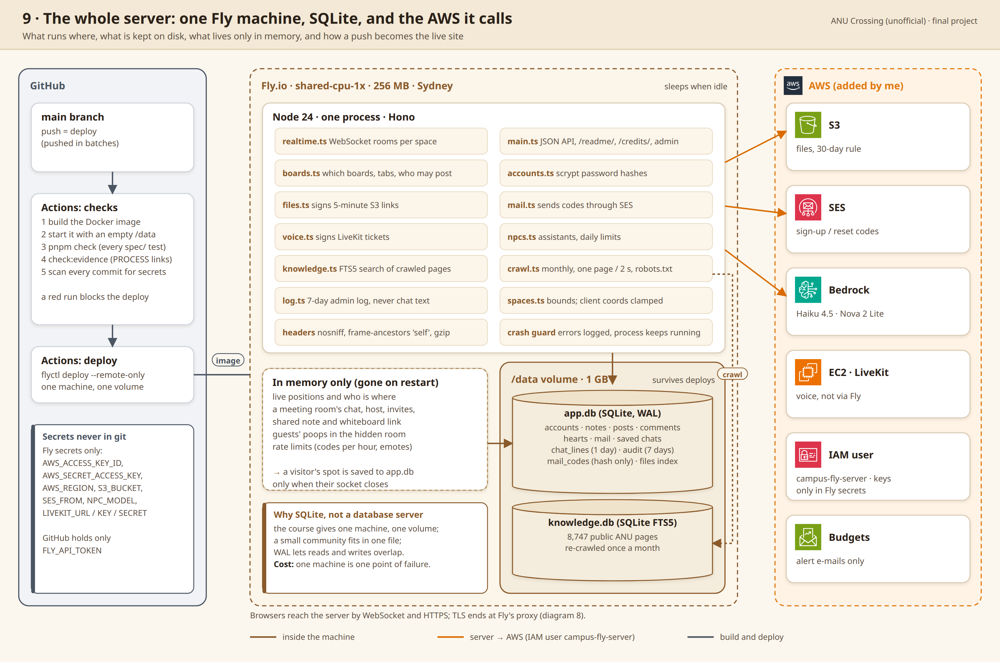

Fly와 GitHub Actions는 코스가 준 거고, AWS는 내가 붙이고 직접 세팅했다. 이유는 미디어였다. 큰 클럽 포스터나 팀 파일은 1 GB 볼륨에 안 들어가서, 파일은 비공개 S3 버킷으로 간다(606b59d). 브라우저가 서버가 서명한 5분짜리 링크로 S3에 바로 올리고, 버킷은 30일 뒤에 다 지운다. 돈이 조금 들지만 크레딧이 있었다. SES는 가입 코드를 보내고(d6ffb2d), Bedrock은 안내원을 돌리고, 음성은 내 t4g.small EC2에서 LiveKit으로 돌린다. 오디오는 앱 머신이 감당하기엔 무겁다.

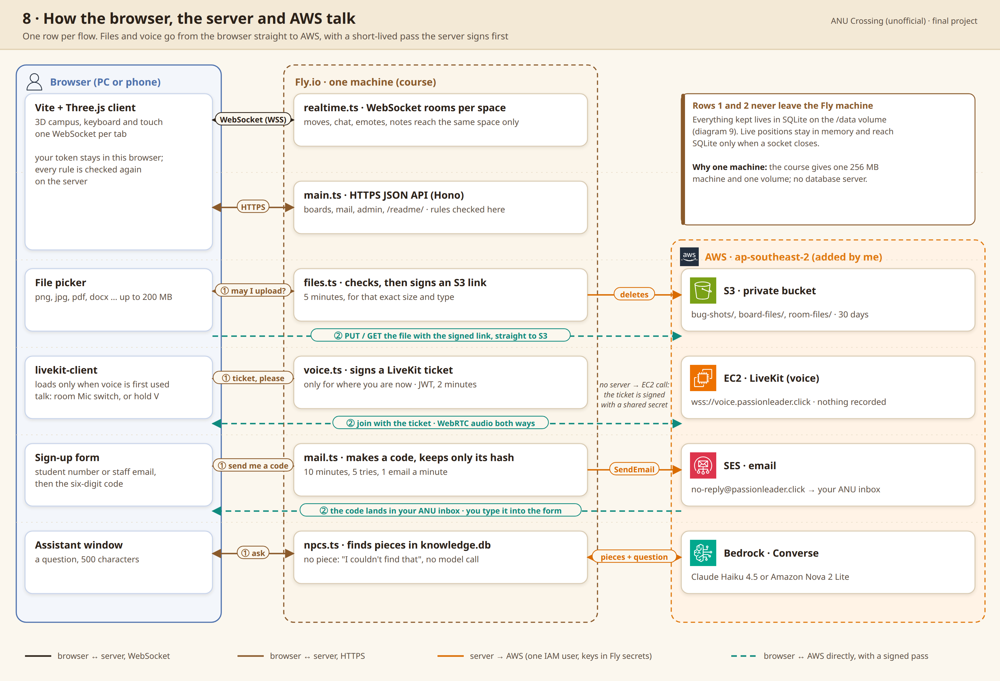

앱은 권한 세 개짜리 IAM 사용자 하나로 AWS에 닿고, 그 정책은 내가 액션 하나씩 손으로 썼다. 이 부분은 AI가 대신 해 주지 않았고, 해서도 안 된다. 돈은 코드로 막혀 있다. 안내원은 하루 한도에서 멈추고, 크레딧이 떨어지면 그렇다고 분명히 말한다(7354a25). AWS Budgets는 메일만 보낸다. 프리 티어엔 자동 차단이 없어서, 진짜 브레이크는 서버의 한도다.

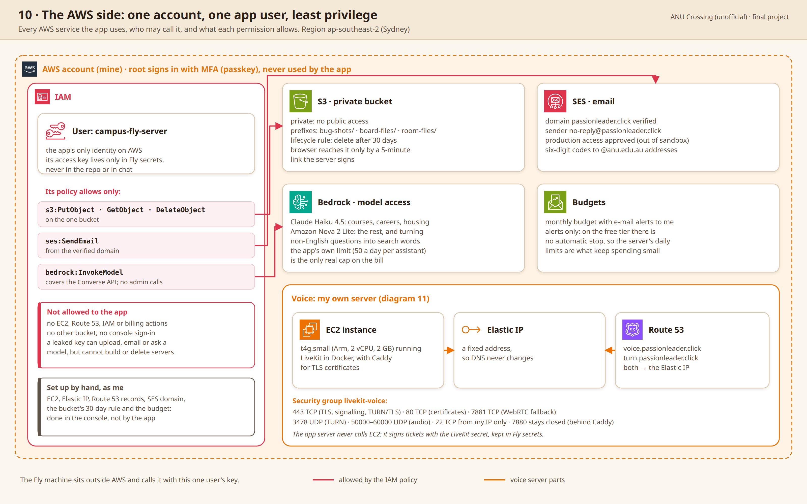

#### 출처에 대한 내 입장

Youssef 외(2024)는 메타버스 플랫폼이 젊은이들의 사회성을 키운다고 했지만, UAE에서 플랫폼 전반을 본 연구다. 캠퍼스 앱 하나가 같은 걸 주장할 순 없어서, README에선 '말 걸기가 쉬워진다'를 증명이 아니라 판단으로 뒀다. Reber와 Sweller를 보고 익숙한 장소가 노력을 덜 든다는 건 납득했다. 그래서 기억에 기대지 않고 지도를 OpenStreetMap과 맞춰 봤다(1068101). 배치는 그대로, 크기만 줄였다. Lee 외(2023)는 학생들이 Zoom보다 Gather.Town에서 팀이라는 느낌을 더 받았다고 했다. 화상회의 하나 더가 아니라 아바타가 있는 공간을 만든 근거다. Bulu(2012)는 함께 있다는 느낌을 만족과 묶는데, 그래서 나한텐 접속자 수와 움직이는 사람들이 가장 중요했다.

#### 계획한 방법: 계획 파일, 체크리스트, 주간 묶음

내 노트는 저장소 밖에 한국어로 있다. `Integreted_plan.md`엔 아이디어를 떠오르는 대로 모으고, 덧붙이기만 한다. 거기서 번호 붙은 체크리스트가 나왔다(영어 번역본: `docs/checklist.md`). 한 주에 하고 싶은 게 생기면 새 번호로 들어가고, 끝난 건 날짜와 커밋 번호와 함께 체크된다. 같은 번호가 커밋 메시지에도 들어가서, 메시지의 '97:'은 체크리스트 97번을 가리킨다(0d920b2). 에이전트는 이 노트를 저장소의 영어 문서로 옮겼다. 계획과 역할(56b1b99, 238efdf)부터 하네스(b83c85b)까지.

일은 묶음으로, 묶음 하나가 예산 한 주였다. 예산은 주 $200에서 $300으로 늘었고, 그 안에서 끝내는 것 자체가 하나의 능력이 됐다. 아이디어가 예산을 넘으면 RICE로 점수를 매겼다. 캔버라 시간을 따르는 밤낮이 2위라서 만들었다(11a6335).

#### 에이전트를 이끈 방법, 그리고 하네스로 고친 것

여러 Claude 세션과 동시에 일했다. 메인(Opus)은 만들고 커밋하고, 보조(Sonnet)는 브라우저 QA를 하고, 더 싼 세션(Haiku)은 안내원에게 시험 질문을 던진다. 각자 무엇을 건드려도 되는지는 `docs/roles.md`에 적어 뒀다. 나는 계획하고, 정하고, 확인한다.

뭔가 틀리면 결과만이 아니라 규칙을 고치려고 했다.

- 다시 시키기 말고 감사. 마지막 점검은 멀티 에이전트 워크플로우로 했다. Sonnet 에이전트들이 코드에서 문제를 찾고, Opus가 하나씩 검증했다. 고친 건 코드에 들어갔고, 일부는 `spec/`에 새 검사도 생겼다. 관리자 PC를 받은 사람끼리 서로의 제한을 풀 수 있던 것(0d920b2), 그리고 틀린 비밀번호에 한도가 생겨 spec이 확인하는 것(d018a1e). 처음엔 찾는 에이전트를 전부 Opus로 돌렸다. 예산만 태우고 30분에 한 영역만 끝나서 중지시켰고, '찾기는 Sonnet, 검증은 Opus'가 규칙이 됐다.
- 원인을 찾고, 그다음 테스트. 안내원의 E 표시가 자꾸 PC 위에 떴다. 원인은 `/api/npcs`가 안내원마다 reach를 안 보낸 거였다. 이제 보내고, spec이 확인한다(3810938).
- 두 번 적어 둔 규칙. 새로 온 사람이 도착하는 곳은 `CLAUDE.md`와 spec에 같이 들어갔다(99c0bec). 나중 변경이 몰래 옮길 수 없게.
- QA가 아니었던 QA. 초반에 메인 세션이 spec 실행과 게스트 스크린샷만으로 테스트했다고 했고, 테스트 로그인이 깨진 걸 찾은 건 나였다. 그 뒤로 브라우저 QA는 보조에게 가고, 안 한 건 안 했다고 적는다. Haiku 결과도 데이터로 다시 확인한다. 지어냈다고 표시한 답 상당수가 사실 다른 페이지에 있었다.

화면은 stageshow 스킬의 디자인 기준을 도구가 아니라 점검표로 썼다. 그래서 모든 창에 같은 Close 버튼, 동그란 버튼엔 같은 선 아이콘, 그리고 폰에서 다른 컨트롤에 가려지는 게 없는 화면이 됐다(a24ccbc, 7be584a, 24f6ba1).

#### 크릿 10 이후

AI 덕분에 만드는 건 쉬워졌고, 그래서 사용자를 아는 게 어려운 부분이 됐다. 크릿에서 친구가 앱에 들어와서는 맵 북쪽에만 머물며 "와 우리 학교 어떻게 구현했어"라고만 했다. 남쪽엔 가지도 않았고 기능은 하나도 몰랐다. 그 친구에겐 학교 배경의 게임이었던 거다. 인스타그램으로 초대한 친구는 그냥 소꿉놀이 게임인 줄 알았다. 결국 기능을 하나하나 설명해 줘야 했다. 미니맵(17e00c4), 튜토리얼(3aeb2b5), 새로 온 사람을 도서관의 Robin에게 데려가는 퀘스트(efaffc0), 앱에서 직접 녹화한 클립이 있는 Campus Guide(b718b00)는 이것 때문에 만들었다. 그 밖에 크게 더한 건 이메일 가입, 크롤한 ANU 페이지로 답하는 안내원(98fc799), 음성, Career Hub, 그리고 밤의 캠퍼스다.

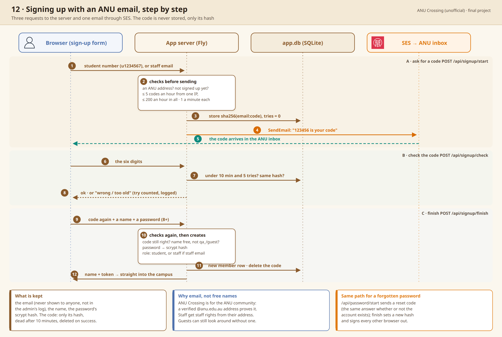

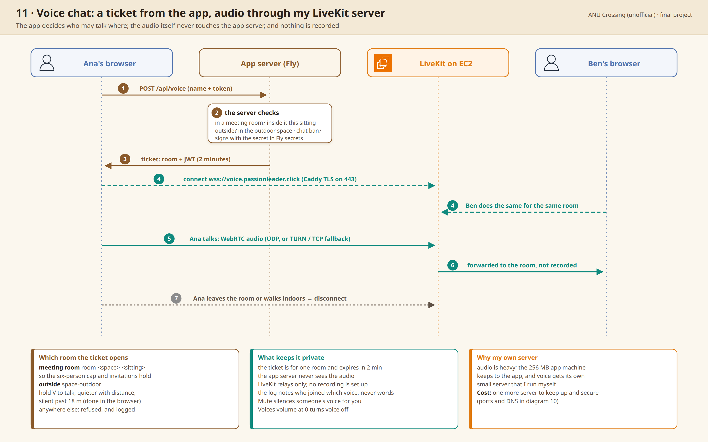

폰 QA는 내가 직접 했다. 데스크톱 브라우저로는 폰을 재현할 수 없고, UI 이슈는 전부 내 스크린샷에서 나왔다. 키보드가 AI 대화창을 가려 대화가 안 됐고, 팀 미팅 룸에선 UI가 화면을 가득 채워 shared note를 쓸 수 없었고, 가로등 불빛은 iOS에서 한동안 색색의 점으로 깨져 보였다.

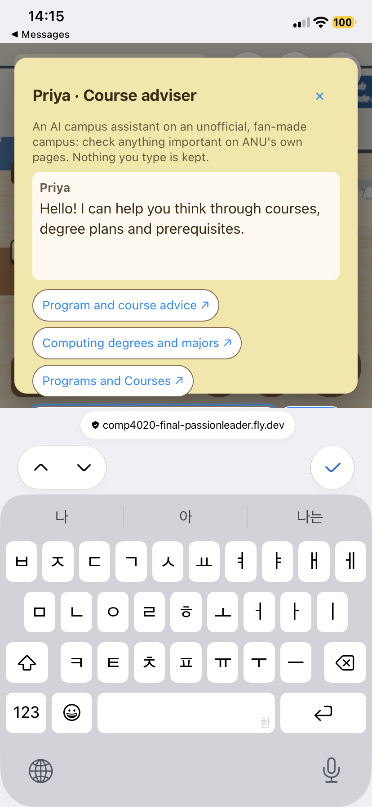

수정은 그 뒤에 따라왔다(8371c85, 0cbc1ed). 무엇을 남기고 누가 보는지는 결정 기록 001과 002에서 논증한다.

---

이 문서와 README는 내가 한국어로 직접 초안을 썼고, 영어 번역과 문법 교정은 AI가 했다.

## 결정 기록 (docs/decisions 001–006)

> 001·002는 크릿 9·10 때 쓴 기록에 이번에 '왜'와 '크릿 10 이후'를 덧붙임. 003–006은 11/9 새로 씀(내 초안 → 영어). 결정 기록은 단어 수에 안 들어감.

#### 001. 무엇이 남고, 누가 보나 (크릿 9, 크릿 10에 수정, 11/9 '왜' 추가)

- 결정: 채팅은 저장 안 하고 1분 뒤 화면에서 사라짐. 스티키 노트만 남음(공간당 5개, 30초에 1개). 모든 건 같은 공간 안에서만 보임. Redis+Postgres 대신 SQLite, 위치는 메모리에만 두고 소켓이 닫힐 때만 저장.
- 왜: 중요하지 않은 데이터는 DB나 영구 스토리지에 둘 필요가 없다. 오히려 서버 리소스만 낭비한다. 그래서 필요한 데이터만 저장했다. 채팅은 최근 몇 분 기록만 남겨서 신고할 수 있게 해 두었다.
- 크릿 10 수정: 노트는 한 달 뒤 사라짐, 맵 채팅은 신고용으로 하루 보관.
- 대가: 늦게 온 사람은 대화를 놓침, 밖에선 Hub에 누가 있는지 안 보임, 머신 한 대라 확장 어려움(장애 땐 백업에서 콜드 스탠바이), 사양 때문에 상시 켜 두기 포기.

#### 002. 누가 무엇을 보고 바꾸나, 서버가 검사 (크릿 10, 11/9 '크릿 10 이후' 추가)

- 결정: 버튼 숨기기가 아니라 서버가 요청마다 검사. 로그·신고는 관리자만(7일, IP 포함, 채팅 내용 제외), 관리자가 1시간~1년 제한, 글은 쓴 사람만 고치고 쓴 사람이나 관리자가 지움, 파일은 S3에서 볼 수 있는 사람에게만 5분 링크, IAM은 필요한 권한만, 거절은 전부 로그.
- 크릿 10 이후: 이메일 인증으로 guest, student, staff, admin으로 나눴다. Notice, 강의실 개설, 상담방은 스태프만 열고 학생을 초대한다. 학생이 채팅, 이상한 게시글, 스티키 노트를 신고하면 관리자가 IP와 내용을 보고 제한하거나 바로 접속을 끊을 수 있다. 모두 안전한 가상 캠퍼스를 위한 것이다.

#### 003. AI 안내원은 ANU 자체 페이지로만 답한다 (파이널)

- 대안: 모델이 자유롭게 답하기 / 웹 검색 붙이기 / ANU 페이지를 크롤해서 그것만 근거로(RAG).
- 결정: RAG. 안내원마다 자기 페이지를 읽고, 질문에 맞는 조각을 주소와 함께 모델에 보냄(98fc799). 맞는 조각이 없으면 모델이 답은 하되 사실은 하나도 말 못 하는 지시를 받아서, "I couldn't find that in my pages"와 링크만 줌. 과목·커리어·주거는 Claude Haiku, 나머지는 Nova 2 Lite, 둘 다 Bedrock(1f07dd2). 질문은 저장 안 함.
- 왜: 과제 등 원래 목적과 맞지 않는 곳에 쓰는 악성 유저를 막고, AI 사용 버젯을 아끼려고. 대신 RAG로 정확도를 올려 보완했다. AI를 제공하는 서비스에서 AI 사용은 곧 돈이라, 효율적인 사용을 유도하는 게 가장 중요하다. 실제로 동료들이 API 키를 알아내려 하거나 AI를 가스라이팅해서 악용하려는 걸 봤다. 이렇게 설계하길 잘했다.
- 대가: 페이지에 없는 건 모름. 크롤을 매달 다시 해야 함. 돈은 하루 한도로만 막힘(사람당 30, 안내원당 50, 전체 한도는 한때 150 → 200, d819ce2). 크레딧이 떨어지면 그렇다고 말함(7354a25).
- 검사: `spec/knowledge.test.ts`.

#### 004. 음성은 앱과 분리된 내 서버에서 (파이널)

- 대안: 브라우저끼리 직접(P2P) / 유료 음성 서비스 / 내 EC2(t4g.small)에 LiveKit.
- 결정: 내 LiveKit. 앱은 지금 있는 곳의 음성에만 쓸 수 있는 2분짜리 티켓만 주고, 오디오는 앱 서버를 거치지 않고 녹음도 안 함(7d000b9, f9bca64).
- 왜: ANU Crossing은 저사양 모바일부터 데스크톱까지 지원한다. P2P는 클라이언트 부담이 크고, 앱 서버를 거치면 아주 작은 Fly 서버에 부담이 가서 전체 서비스에 영향이 갈까 걱정됐다. 그래서 AWS 크레딧을 좀 쓰더라도 메인 서비스와 음성을 안정적으로 분리했다. 크레딧이 떨어지거나 AWS 장애로 EC2가 내려가도 ANU Crossing은 정상 작동한다.
- 대가: 관리할 서버가 하나 늘어남(포트, 인증서, DNS). 켜져 있는 동안 계속 크레딧이 듦.
- 검사: `spec/knowledge.test.ts`(티켓은 방 하나, 시크릿 서명, 짧은 유효기간).

#### 005. 자유 이름 대신 ANU 이메일 인증 가입 (파이널, 002의 대가를 해결)

- 대안: 아무 이름(크릿 8·9 방식) / ANU 로그인 연동(학생 프로젝트엔 안 열림) / ANU 이메일로 6자리 코드.
- 결정: 이메일 코드. SES로 보내고 해시만 저장(d6ffb2d). 직원 주소로 가입하면 staff, 역할은 guest·student·staff·admin. 게스트는 둘러보고 채팅하고 안내원에게 물을 수는 있지만 글은 못 씀. 로그인은 계정 유무를 안 알려 줌(33e4795), 틀린 비번 10번이면 15분 대기(d018a1e). 강의실과 상담방은 스태프가 열고 학생을 초대(7965edb).
- 왜: 인스타그램으로 무작위 사용자를 모집했을 때, ANU 구성원이 아닌 사람이 게시판에 트롤링을 시도했다가 권한 부족으로 막혔다. 트롤링을 막고, 개인정보를 보호하고, 안전한 가상 캠퍼스를 만들려고 이렇게 설계했다. 학생들은 익명이라고 생각할 수 있지만 학번은 서버 로그에 남는다(관리자만, 7일). 그래서 괴롭힘이나 욕설에 대비해 신고 기능도 넣었다.
- 대가: SES 설정과 운영 승인이 필요했음. 가입이 2분쯤 걸림. 게스트는 할 수 있는 게 적음.
- 검사: `spec/campus.test.ts`, `spec/rooms.test.ts`.

#### 006. 에이전트 세션 여러 개, 일에 맞는 모델로 (크릿 10, 파이널에 확장)

- 대안: 세션 하나, 모델 하나로 차례대로 / 세션 여러 개를 병렬로, 각자 역할과 모델.
- 결정: 병렬. 메인(Opus)이 만들고 커밋, 보조(Sonnet)가 브라우저 QA, Haiku가 크롤 데이터 확인과 안내원 시험 질문. 각자 권한은 `docs/roles.md`(238efdf). 리뷰 워크플로우는 찾기 Sonnet, 검증 Opus.
- 왜: 병렬 처리로 작업 시간을 줄이는 게 가장 중요했다. 구현과 동시에 QA를 할 수 있어서 꽤 효율적이었다. 모델을 나누면 버젯도 아낄 수 있다. QA는 Sonnet으로 충분했고, 크롤 데이터 확인은 Haiku로 했다. 작업에 맞는 모델로 효율적으로 개발했다.
- 대가: 보조 결과도 다시 확인해야 함(Haiku가 지어냈다고 한 답이 사실 다른 페이지에 있었음). 커밋은 메인만 해서 한 단계 더 거침. 모델을 잘못 고르면 비쌈(첫 워크플로우를 전부 Opus로 돌렸다가 중지).
- 검사: spec이 아니라 사람이 판단. `docs/roles.md`와 커밋 기록.

## 파이널 리플렉션 (reflections/final.md)

> 크릿 8·9·10 리플렉션과 따로, 파이널 전체에 대한 리플렉션. 채점 스크립트가 읽는 파일명은 아님(경고만 뜸, 통과에는 영향 없음).

#### 일을 앞으로 나아가게 한 돌파구

계획은 내가, 실행은 에이전트가. 아이디어가 떠오르면 바로 노트에 적고, 체크리스트 번호가 되고, 에이전트가 만들고, 그 번호를 단 커밋으로 들어가고, 커밋 번호와 함께 체크된다. 이 흐름이 자리를 잡자 나는 코드가 아니라 아이디어를 관리하게 됐고, 프로젝트는 혼자서는 못 냈을 속도로 나아갔다.

#### 내가 되고 싶은 개발자

구현은 이제 AI로 아주 쉽게 가능하다. 원하는 프로그램을 만들어 웹 브라우저로 누구나 접근하게 배포하는 것도 거의 한 번에 된다. 그러면 데이터와 콘텐츠가 넘쳐나고, 사람들은 쉽게 싫증을 느낀다.

그래서 나는 구현이 쉬워질수록 사용자를 알아야 한다고 생각한다. 사용자가 정말 필요한 건 무엇인가? 내 서비스에서 불편한 건 무엇인가? 이건 모두 '인간의 경험'에서 나오는 감각이라 AI가 대신 찾아주지 않는다. 이게 채워지지 않으면 AI로 양산해 낸 수많은 쓰레기 콘텐츠 중 하나가 될 뿐이다.

그래서 대충 만든 프로토타입보다 완성도 높은 실제 서비스로 이목을 끄는 게 아주 중요하다. 추진력과 섬세함을 두루 갖춘 '살아남는' 개발자가 되고 싶다.

## 리서치 노트 (research-note.md, COMP8020)

> 영어 원본은 `comp4020-final-passionleader/research-note.md`. 본문 789단어(600–800), 참고문헌 5개 모두 링크 확인함. 11/9 새벽 내 한국어 초안을 테크 블로그 톤으로 옮김.

#### 코드가 싸져도, 무엇을 만들지는 누군가 정해야 한다

"새 코드를 내놓는 값은 거의 공짜가 됐다. 하지만 좋은 코드를 내놓는 건 여전히 훨씬 비싸다"(Willison, 2026). 자꾸 이 문장으로 돌아오게 된다. 이제 누구나 오후 한나절이면 앱을 만들어 웹에 올릴 수 있고, 그래서 웹은 앱으로 넘쳐나고, 사람들은 금방 질린다. 내 입장은 이렇다. 좋은 에이전트 개발은 이제 에이전트가 줄 수 없는 두 가지에 달려 있다. 만들기 전에 시스템 전체를 보는 눈, 그리고 그걸 쓸 사람을 아는 것. 둘 다 없으면 양산형 콘텐츠 더미에 하나를 더 얹은 것뿐이다.

#### 큰 그림은 이제 개발자의 일이다

Willison이 꼽는 '좋은 코드'의 조건이 의미심장하다. 작동하고, 작동한다는 걸 우리가 알고, '맞는 문제를 푼다'. 앞의 둘은 에이전트가 많이 도와줄 수 있다. 세 번째는 판단이고, 모든 프롬프트보다 앞에 있다. 어떤 스택, 어떤 서비스, 범위를 어디까지 넓힐지. 에이전트는 시키는 건 기꺼이 만들지만, 잘못 시켰다고는 말해 주지 않는다.

그래서 드문 능력은 기술을 많이 아는 게 아니라고 본다. 이 서비스에 무엇이 필요한지, 그게 어떻게 맞물리는지 아는 거다. 문헌 밖에서 작은 예를 봤다. 인스타그램(ai_freaks.kr, 2026)에 올라온 한국 대학생 OpenAI 해커톤 소식에서, 우승 팀이 8시간 중 3시간을 회의에 썼다고 했다. AI가 코드를 써 주는 대회에서, 그들은 시간의 거의 절반을 무엇을 만들지 정하는 데 썼다.

#### 무엇을 만들지는 현장 조사가 정한다

나머지 절반은 사람이다. 책상에서 상상한 요구사항만으로는 부족하다. 사람들이 어디서 어떻게 쓰고 어디서 막히는지 직접 봐야 한다. Nielsen(2002)은 현장 조사가 프로젝트 방향을 정하고 아직 채워지지 않은 요구를 찾는 가장 값진 방법 중 하나이며, 사람들이 하는 말만 듣지 말고 실제 행동을 봐야 한다고 했다.

내가 전공 세부 분야로 Human-Centred and Creative Computing(HCCC)을 고른 이유도 여기 있다. 나에게 UX 리서치는 마지막에 화면을 다듬는 일이 아니다. 처음에 어떤 문제를 풀고 무엇을 먼저 만들지 정하는 일이다. 기능 하나 만드는 값이 거의 0이 되면 이 첫 결정이 더 중요해진다. 잘못된 걸 만드는 걸 막아 줄 게 아무것도 없으니까.

솔직히 빈틈도 있다. Nielsen은 사용자 연구가 왜 중요한지는 보여 주지만, 코딩 에이전트보다 20년 앞서 쓴 글이라 에이전트 때문에 그 중요성이 더 커졌다는 것까지는 보여 주지 못한다. 그 부분은 내가 직접 본 것에서 나온 내 주장이다.

#### 반론: AI가 리서치까지 하면?

진지한 반론은 HCI 문헌 안에서 나온다. Xuan 외(2025)는 생성형 에이전트가 사람과 어시스턴트의 상호작용을 흉내 내는 플랫폼을 만들고, 기존 사용자 연구 10개를 실제 참가자 없이 재현해 핵심 결론을 다시 얻었다. 가상의 사용자가 진짜 사용자를 대신할 수 있다면 UX도 결국 에이전트 몫이 될지 모른다. 솔직히 읽고 조금 슬펐다.

일부는 인정한다. 초기의 가벼운 평가는 AI가 맡을 수 있다. 하지만 보고서를 읽는 것과 누군가 내 서비스에서 막히는 걸 직접 보는 건 다르다. Rosala(2026)가 내가 원하던 구분을 해 준다. AI가 연구자만큼의 결과물을 내더라도 사람이 이끄는 연구는 여전히 중요하다. 팀은 사용자를 관찰하면서 배우고, 그 배움은 외주를 줄 수 없기 때문이다. 그는 일을 둘로 나눈다. 참가자 모집, 녹취, 자료 정리는 지원 작업이라 AI에게 넘겨도 된다. 진행, 관찰, 해석에 배움이 있다.

Xuan 외가 시험한 것에도 한계가 있다. 그들은 실제 연구가 이미 찾아낸 결론을 재현했다. Nielsen이 말하는 현장 조사의 가치는 그 반대, 아직 아무도 적어 두지 않은 요구를 찾는 데 있다. 시뮬레이션은 이미 아는 걸 확인할 수는 있다. 우리를 놀라게 할 수 있는지는 훨씬 불분명하다. 친구가 내 캠퍼스 앱을 써 봤을 때, 맵 북쪽에 서서 "와 우리 학교 어떻게 구현했어"라고만 하고 기능은 하나도 찾지 못했다. 나는 그걸 예상하지 못했고, 그러니 내 가정으로 만든 시뮬레이션도 예상하지 못했을 거다.

#### 개발자는 어디에 서야 하나

그래서 '좋은 에이전트 개발이란 무엇인가'에 대한 내 답은 일의 분담이다. 코드와 리서치의 지원 작업은 에이전트에게 맡긴다. 시스템 전체를 보는 일과 진짜 사용자를 지켜보는 일은 내가 쥐고 있는다. 싸게 만든 코드가 쓸 가치가 있었는지는 그 두 가지가 정하니까.

코딩은 누구나 배우는 교양 과목이 되어 가고 있다. 여전히 드문 건 무엇을 만들 가치가 있는지 정하는 일이고, 그 결정은 여전히 사람을 지켜보는 데서 시작한다.

#### 참고문헌

- ai_freaks.kr (2026). 대학생 OpenAI 해커톤 우승 팀 소식 [인스타그램 게시물]. https://www.instagram.com/p/DeeEqoKmlkW/
- Nielsen, J. (2002, 1월 19일). *Field studies done right: Fast and observational*. Nielsen Norman Group. https://www.nngroup.com/articles/field-studies-done-right-fast-and-observational/
- Rosala, M. (2026, 7월 17일). *Why human-led research still matters in the age of AI*. Nielsen Norman Group. https://www.nngroup.com/articles/human-led-research-still-matters/
- Willison, S. (2026). Writing code is cheap now. *Agentic engineering patterns* 중. https://simonwillison.net/guides/agentic-engineering-patterns/code-is-cheap/
- Xuan, Z., Wu, Y., Xu, X., Namboodiri, V., Chuah, M. C. & Yang, Y. (2025). Design and evaluation of generative agent-based platform for human-assistant interaction research: A tale of 10 user studies. *Proceedings of the ACM on Interactive, Mobile, Wearable and Ubiquitous Technologies*, 9(4). <https://doi.org/10.1145/3770661>
