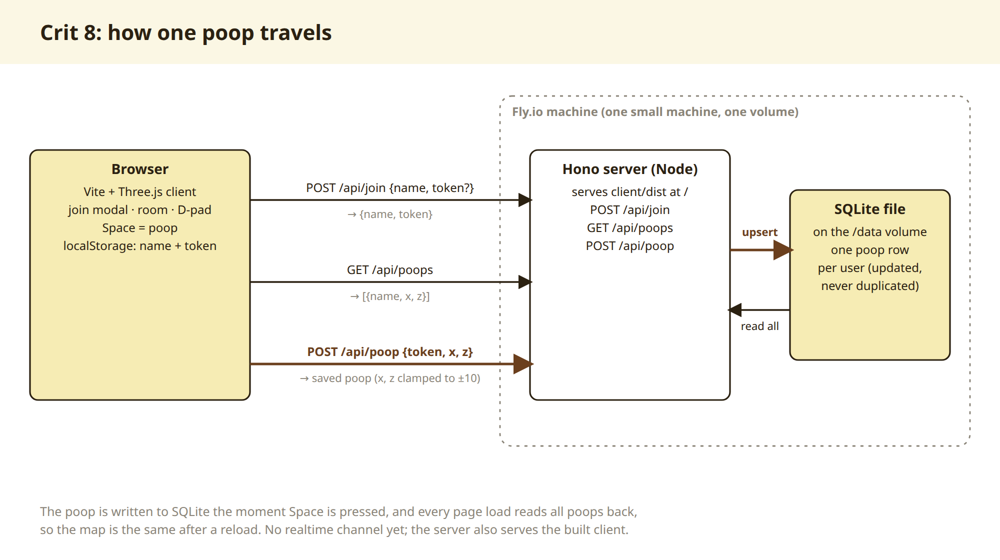
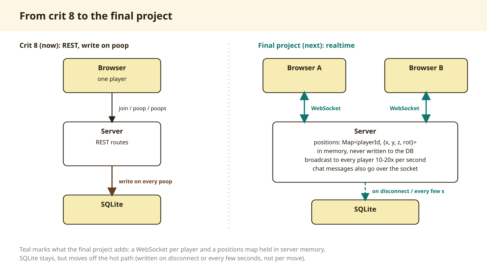
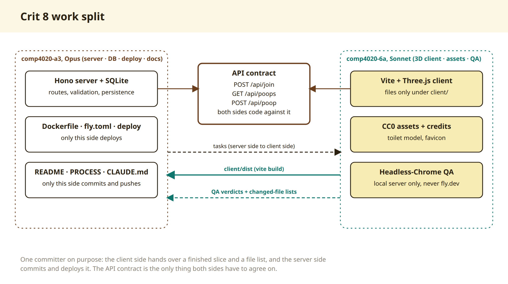

# Final project plan)
> 
> 이 파일은 절대 수정하지 말고, 하단에 내용을 추가하는 방향으로 간다.

# Final project plan

## 컨셉

* 로블록스 비슷한 공간, 근데 "게임"이라기보단 사람들 모여서 소통하는 실시간 소셜 공간.
  
  * 참고: Gather.town, VRChat lite 느낌
  
  * 3D로 구현할 거고, 3인칭 시점을 지원한다 (생각보다 크레딧이 많아서 3d로 결정)
  
  * 게임과 비슷하게 실시간 채팅, 음성 채팅(후순위)이 가능하고, 물건과 상호 작용이 가능하다
  
  * "우편" 기능으로 비 접속시 확인할 수 있는 우편 기능을 도입
  
  * 언제 어디서나 '스티키 노트'를 붙여 흔적을 남길 수 있다. 하단 인터랙션 파트 참고
  
  * 
- 만들고자 하는 방향
  
  - ANUHub (공간)
    
    - 현재 ANU Hub의 고민은, 비 공식적인 Staff(특히 교수)랑 학생의 접점이 없다는 것이다.
    
    - 학생들은 연구 지도교수를 찾고, 지도교수는 관심 있어하는 학생을 쉽게 찾을 수 있다. 친목도 가능.
    
    - 게시판 UI를 열어서, 랩실 홍보하기, 학생이 랩실 구하기 게시물을 쓸 수 있음. 순전히 본인 선택. 실제 서비스가 아니므로 교수랑 학생 구분은 불가능하니까 이는 감안한다
    
    - 그 외에 ANUHub에서 지원하는 내용을 이 가상의 공간에서 지원한다.
    
    - 크게 생각하는건 네 가지인데
      
      - 연구지도교수/학생 찾기 게시판 - 교수를 인증할 방법이 없으므로 게시글 UI를 띄워 교수 탭 / 학생 탭 각각 랩실구해요 학생구해요 이런 게시글 작성하는 것으로 
      
      - 홍보 게시판(건물 외부에 존재 - 동아리 및 이벤트 등 홍보
      
      - 1:1 채팅방
        
        - 파일 첨부(png jpg pdf 5mb까지 허용)
        
        - 실시간 음성 채팅(후순위로 미룸. 가능하면 진행)
        
        - 텍스트 채팅
      
      - ANU Hub에 문의하기
        
        - (게시판에 문의글 남기기 - 메모: 공식 서비스가 아니라는 점을 고지) 이 정도?
  
  - '강의실'
    
    - ~~학생들은 수강 중인 강좌의 온 에어중인 echo360을 실시간으로 보고 댓글을 달 수 있다.~~
    
    - ~~교수 및 학생의 파일 공유도 가능하다~~
    
    - 위 취소선 내용을 사실상 불가능.  강의 시간대에 맞춘 댓글판이나 질문판을 운영하는 것으로 만족
    
    - 강의실명은 MGMP2222, COMP6300이런 형태이고, 방의 유효기간은 6개월(한 테이블에 강의실 행을 두고 6개월 지난 행을 삭제하는 방식)
    
    - 강의실은 qa_master만 만들 수 있다. 일단 초기 강의실은 COMP8020 하나만 생성
  
  - (보류) - 클럽
    
    - 동아리(클럽) 공간
    
    - 클럽을 홍보하고 가입할 수 있다.
    
    - 클럽룸이 있어서 커스터마이징 및 회의가 가능하다 
  
  - (보류) - 기숙사
    
    - 기숙사 룸에서 커뮤니티 사교활동 가능
  
  - (보류) - 대학(CSS)공간 내에 강의실처럼 쪼개진 코스(MCOMP)공간들. 자신의 대학/코스만 입장 가능
    
    - 대학 및 코스의 공지사항을 전파하고, 문의를 남길 수 있다.
    
    - 물론 선배를 마주치면 인사해서 친해질 수 있음
    
    - 애초에 교수 찾기를 여기로 넣을지도 생각 중. 여기에 넣으면 타 학과 연구실과는 접점이 없어지겠지? 음..

## 기술 스택

기술 스택

- 영속 데이터: SQLite를 volume에 두고 접속 종료 좌표와 아이템 기록을 저장해요. 쓰기는 접속 종료 시점이나 몇 초 간격으로 한다

- 실시간 위치: 서버 메모리에 Map<playerId, {x,y,z,rot}>로 두고 WebSocket으로 브로드캐스트한다. 초당 10~20회 정도의 틱으로 보내면 됨. DB에는 쓰지 않음

- 통신: 채팅 같은 메시지도 WebSocket 기록이 필요하면 SQLite 테이블에 쌓음.

- 클라이언트 렌더링: WebGL (Three.js나 Babylon.js)

- 실시간 동기화: WebSocket > Crit8에는 실시간 동기화 불 필요. 다만 스티키 노트를 남길 떄 위치(좌표)는 즉시 DB에 저장 되어야 함
  
  - 서버 프레임워크 후보: Colyseus (room 기반 상태 동기화, 직접 구현보다 서버 코드량 줄어듦)

> 클라이언트 (client/src/net.ts)
> 
> - 내 위치는 일정 간격마다 보내는데, 그 사이에 움직였을 때만 보냅니다. 가만히 서 있으면 아무것도 보내지 않습니다.
> - 보낸 뒤 서버의 답을 기다리지 않고 화면 그리기를 계속합니다.
> - 다른 사람의 움직임은 ws.onmessage로 언제든 도착하고, 도착하면 그 사람 위치 목표값만 바꿔 둡니다. 실제 캐릭터는 매 프레임 그 목표를 향해 부드럽게 따라갑니다.
> - 연결이 끊기면 다시 연결을 시도하는데, 간격을 점점 늘려서 최대 8초까지 기다립니다.
> 
> 서버 (server/realtime.ts)
> 
> - Node.js는 스레드 하나의 이벤트 루프로 돌아갑니다. ws.on("message"), ws.on("close") 같은 콜백이 메시지가 올 때마다 실행되므로, 한 사람을 처리하느라 다른 사람이 막히지 않습니다.
> - 받은 위치를 바로 모두에게 돌리지 않습니다. 해당 공간에 "변경 있음" 표시만 해 두고, 타이머(setInterval)가 1초에 10번 정도 바뀐 공간에만 한꺼번에 보냅니다.
> - 요청에 응답하는 구조가 아니라 서버가 먼저 보내는(push) 구조입니다. 같은 공간에 있는 사람에게만 보냅니다.
> - 응답 없는 연결은 주기적인 ping으로 찾아내서 끊습니다.
> 
> 한 가지 예외: DB 저장은 동기식입니다.
> 
> - node:sqlite의 DatabaseSync를 쓰기 때문에, 노트를 저장하거나 접속을 끊을 때 마지막 위치를 저장하는 순간에는 이벤트 루프가 아주 잠깐 멈춥니다.
> - 실시간 위치는 메모리에만 두고 움직일 때마다 DB에 쓰지 않기 때문에 지금 규모에서는 문제가 없습니다. CLAUDE.md 규칙대로입니다.
> - 결정 기록이나 crit에서 "전부 비동기냐"는 질문을 받으면 "통신은 비동기, SQLite 쓰기는 동기지만 이동할 때마다 쓰지는 않는다"고 답하시면 정확합니다.

## 배포 (Fly.io)

- ~~기본 course 설정은 scale-to-zero (`min_machines_running = 0`) → 비용은 거의 안 들지만 WebSocket 상시 연결과 궁합 안 좋음~~
- ~~데모/크리틱 때는 `min_machines_running = 1`로 always-on 전환 고려~~
- 학교가 보는 설정이니 건드리지 말라고 하니 0으로 유지한다. 에효
- always-on 비용이 course 예산 범위 안에 드는지 불명확 → comp4020@anu.edu.au에 문의 필요
- [https://comp4020-final-passionleader.fly.dev/](https://comp4020-final-passionleader.fly.dev/) 띄워 둔 상태

## Claude Code 예산

- $300 Sonnet 예산이면 이 스코프엔 충분해 보임
- 비용 절약 팁: 세션을 자주 새로 열지 말고 하나로 길게 이어가기 (cold start마다 ~$0.10 고정 비용)
- WebGL 디버깅할 때 스크린샷 반복 첨부가 비용 많이 먹는 요인이니 주의 (하지만 예산 남으면 감당 가능)

## 맵 디자인

* ANU캠퍼스 사진과 위성지도 캡쳐를 참고용으로 첨부할 예정. 필요시 나한테 요청해라
  
  * OpenStreetMap 건물 윤곽(출처 표기)을 바탕으로 사용도 가능

* 캠퍼스 (제일 외부 맵)만 실제와 비슷한 느낌으로 진행

* 강의실/건물 내부는 커스터마이징 가능 

* 맵은 하나로 전부 구현하지 말고, 문 앞에서 E키를 눌러 장소 이동하는 방식으로 공간 하나씩마다만 렌더링한다

## 어셋

* BGM은 Gemini로 생성된 AI음악 사용 예정, 이 점 고시 필요. 필요할 때마다 나한테 브금 만들어 달라고 하기

* 어셋은 직접 생성하거나 웹으로부터 무료 어셋 사용한다

## 캐릭터 디자인

* 단순한 사람 형태

* 커스터마이징: 피부 색, 머리 색깔, 눈 색깔, 옷의 색 정도로 생각 중임

## 조작

* WASD로 조작한다, space로 점프한다, ESC로 환경 설정(음량 조절, 그래픽 설정, 라이선스  확인, 크레딧_만든사람, 언어) 가능.

* Q로 인터랙션 메뉴 (GTA5 무기 고르는 창처럼) 표시
  
  * 포스트잇 생성
  
  * 인사하기
  
  * 네 / 아니오
  
  * How ya doing mate (말풍선)
  
  * 춤추기

* E로 상호작용
  
  * 게시판 열기
  
  * 포스트잇 보기
  
  * (문 앞에서) 맵 입장하기

* F 버튼을 누른 상태로 대화할 수 있음. 

* 엔터 버튼으로 채팅도 가능함 엔터 누르면 캐릭터 위에 말풍선으로 띄운다

* 왼쪽 하단에 채팅창이 있고, 채팅 내역은 1분이면 사라짐 ~~(번역 기능 추가 가능하려나, 환경 설정에서 고른 언어로 번역됨)~~

* 기본 가이드는 현재 구현된것과 같이 가이드라인을 하단에 표시한다.

## 그래픽

* 너무 찰흙같지 않으면 됨. 

* 낮은 사양에서 고품질이면 좋겠는데.. 바닥 벽돌 등

* 물론 모바일 웹에서 돌릴 수 있는 사양이어야 함

* 환경 설정 - 그래픽 옵션에서 저사양용(찰흙같은 그래픽 가능), 및 고사양용 선택 가능하면 좋을듯. 그림자도 켜고 끌수 있음 좋겠다

## 로직(원하는 기능)

- 인증하기
  
  - ~~학생인증, 임직원 인증 기능 만들 수 있으려나... 아무튼 anu.edu.au 이메일 있어야만 사용 가능~~
  
  - ~~위 기능은 회원가입 시에 인증절차를 거친다.~~
  
  - ~~이게 불가능하다면, 애초에 처음 닉네임 고를때 ex) u8321477 + 비밀번호 생성으로 진행~~
  
  - ~~게스트로 진행 가능하며, (인증 구현이 된다면) 게시글 작성 등에서 인증이 필요한 기능으로 인증 화면을 띄움~~
  
  - 위 취소선 내용 사실상 불가능하니, 닉네임으로 진행한다

## QA진행

* 작업 후 qa_bot01~10으로 테스트를 진행한다 (미리 DB에 만들어 둠)

* 마스터 계정도 미리 만들어 두어야 함(qa_master) -> 이건 관리자 전용 계정으로 내가 접속할 거임

* QA역할로 어떤 점이 이상한지 클로드 코드가 직접 검증 진행. 브라우저를 직접 컨트롤 해도 되고 브라우저 로그/렌더링 오류 같은거 같이 봐야 함.

* 테스트를 위해 그 어떤 짓도 해도 됨. DB 버그를 발견해서 무한 포스트잇을 쓴다던가.. 다만 발견했으면 고쳐야겠지?
- 관리자 및 테스트 계정 위치
  
  - `qa_master`(관리자), `qa_bot01` ~ `qa_bot10`(일반 사용자) 비밀번호는 저장소 밖 **`~~/.config/comp4020/accounts.txt`** 에 있음 (본인만 읽기 가능, 권한 600).
  - 공개 저장소(학교/개인 둘 다)에는 비밀번호를 절대 넣지 않는다. 

## 문서화

* CLAUDE.md에 넣을 규칙(이미 적용되어 있을 것이다.)
  
  * "커밋은 기능 하나씩 작게"
  
  * 모든 문서는 영어로 작성
  
  * 내가 작업을 줄 때마다 process.md 하단에 "history"로 커밋넘버와 함께 간단히 기술해 둘 것
  
  * 주차가 변경되었을 때 이 부분은 초기화 되고 덮어쓴다 (week8에 쓴 히스토리는 week9작업 시작 시 제거)

* 아무튼 process.md 하단에 히스토리 짧게 커밋넘버와 쓰도록.

### Final Project 과정 리플렉션

* What is good (readme.md에 적용할 것)
  
  * 친숙한 공간을 모바일로 모델링 하여 거부감이 없도록 한다 (익숙한 공간의 중요성 > 레퍼런스 첨부할 것 찾아야 함)
  
  * 3D공간이 주는 특성: 매일 업무할 때 보는 2d 공간이 아니라 누구라도 편히 쉴 수 있는, 마치 게임과 같은 공간을 제공하고 싶었다. 따라서 BGM과 외관 디자인 등에 큰 노력을 쏟았다
  
  * 오프라인으로 쑥쓰러운 사람들에게 온라인으로 사교 활동을 진행할수 있음. 학생과 교직원의 허물 없이 누구나 쉬운 커뮤니케이션을 지향한다
  
  * (Crit9) 실시간으로 학급 동료들을 마주치고, 인사하고, 대화를 건네는 친숙한 공간을 만들고 싶었다. 원하면 Sticky Note 를 붙여 나의 흔적을 기록하고 학급 친구들이 댓글을 달아 소통에 재미를 더한다. 같이 춤도 출 수 있다.

* 구현 전
  
  * ANU Library 자료 검색 등 창을 E키 만으로 손쉽게 찾아서 원하는 페이지에 쉽게 접근할 수 있다.
  
  * 아직 구현 전이긴 한데, 협업할 수 있는 워크스페이스를 메타버스로 구현하여 실제로 쓸모가 있도록 하는 것이 목표이다.

* 리플렉션
  
  * 아이디어는 언제 어디에서 좋은 아이디어가 떠오를 지 모른다. 나는 아이디어가 떠오를 때마다 메모해 두고, 추후 작업할 리스트로 남겨 두는 방향으로 진행했다
  
  * UX는 인공지능이 모른다! 뭐가 불편하고 뭐가 편한지 이 관점을 잘 모름. 이건 인간의 경험으로만 수정하고 개선할 수 있는 영역이다! 
  
  * 

## 개인 포트폴리오 전용 저장소에 어떻게 적지? 서버 링크는 하나인데?

* 일단 Crit 8~10 서버는 하나를 쓰더라도, 일단 각 레포는 복사해서 구분해서 각각 올려둔다. (지난주꺼 보고싶으면 지난주 디렉터리만 다운받으면 되니까) 

* 다만 readme.md에서 서버 링크는 빼야 함. 왜냐하면 crit8~crit10 모두 같은 프로젝트 링크가 뜰 텐데 이상하잖아? 서버 링크는 가장 마지막 프로젝트에 올려둔다

* 대신에 현재 crit8에서 했던 것처럼 스크린샷 하나를 남겨 둔다.

## 역할 분담 (세션 운영 규칙)

> 학교 저장소에는 영어로 `docs/roles.md`에 정리되어 있고, `CLAUDE.md`에서 `@docs/roles.md`로 연결해 둠 (커밋 238efdf). 그래서 저장소에서 여는 모든 세션이 자동으로 읽음.

#### 세션 관리 방법

- 기본은 **세션 2개**: 메인(Opus high) + 보조(Sonnet medium).
- 세션을 늘리면 cold start 비용, 같은 파일 동시 수정 위험, 조율 시간이 늘어나서 아낀 시간보다 손해가 큼.
- 큰 QA나 에셋 찾기처럼 **파일이 안 겹치는 일회성 작업**만 세 번째 세션을 잠깐 열고, 보고 받으면 닫는다.

#### 메인 세션 (Opus)

- **PM / 통합**: 작업 쪼개기, 보조에게 줄 작업 작성, API 계약과 파일 구조 결정, 보조 결과물 합치기
- **백엔드 + 실시간 통신**: `server/` 전체 (라우트, 검증, SQLite, WebSocket 프로토콜)
- **프론트엔드 핵심**: `main.ts`, `net.ts`, `api.ts`, `world.ts`, `index.html`, `style.css` 같은 공용 파일
- **배포 / 운영**: Dockerfile, 배포(공개 후엔 CI), DB 초기화·백업, 배포 후 라이브 확인
- **로그 / 관측**: 서버 로그, 실시간 활동 보기 (crit 10)
- **문서 / 하네스**: README의 사실 부분, CLAUDE.md, docs/, 결정 기록, PROCESS History 관리, 내 초안 번역. **README·PROCESS·reflection의 주장과 생각은 내가 쓴다**
- **코드 리뷰**: 보조가 넘긴 결과물은 커밋 전에 메인이 검토
- **커밋 담당**: `git add / commit / push / tag`는 메인만 한다
- effort: 기본 **high**, 실시간 설계·동기화 버그·운영 DB 건드릴 땐 **xhigh**, 문서 수정·작은 수정은 **medium**

#### 보조 세션 (Sonnet)

- **디자인 / 에셋**: CC0 등 라이선스 확인된 모델·사운드·이미지 찾기, `CREDITS.md`에 출처 표기
- **UI 부품**: 메인이 지정한 독립 모듈만 만든다 (예: 키 가이드 `keyguide.ts`). API는 메인이 정해 준 대로
- **QA / 테스트**: 로컬 서버에서 헤드리스 브라우저 테스트 (브라우저 2개 동시 접속, 데스크톱·폰 화면, 키보드만으로 조작, 콘솔 에러, 스크린샷)
- **접근성 / 반응형 점검**: 키보드만으로 플레이, 터치 조작, 사용 중 창 크기 바꾸기 (마커가 실제로 해 보는 것들)
- **보안 / 개인정보 점검**: 읽기만. 입력 제한, 토큰 처리, 비밀값이 저장소에 없는지
- effort: 기본 **medium**, 단순 반복 작업(이름 바꾸기, 에셋 옮기기, 기존 QA 스크립트 재실행)은 **low**

#### 보조 세션 절대 금지

- 작업에서 지정받은 파일 말고는 만들거나 고치지 않는다
- git 명령, 배포, `flyctl` 금지
- 테스트는 `http://localhost:8080`에서만. `*.fly.dev`에는 테스트 트래픽 금지

#### 커밋 규칙

- **커밋은 메인 세션 하나만 한다.** 기록이 하나의 이야기로 읽히고, 두 세션이 동시에 git을 건드려 꼬이는 일이 없다.
- 보조는 끝난 작업과 바꾼 파일 목록을 넘기고, 메인이 검토 후 "보조 세션에서 만든 것"이라고 커밋 메시지에 밝혀서 커밋하고 PROCESS History에 한 줄 추가한다.

#### 작업 주고받기

- **메인 → 보조**: 할 일, 만들거나 고쳐도 되는 파일 목록, 맞춰야 할 API, 확인 방법(`npx tsc --noEmit`, 찍을 스크린샷), 보고 시각
- **보조 → 메인**: 완료 여부, 바꾼 파일 목록, 항목별 테스트 결과, 콘솔 에러, 스크린샷 경로, 작업 밖에서 발견한 문제(고치지 말고 보고만)

#### 라이브 사이트 테스트

- 운영 사이트는 메인 세션만, 그리고 재사용하는 **`qa_bot01~10` 계정 으로만** 테스트한다.

## 구현 순서 (전체, 후순위 포함)

> 앞 단계가 뒤 단계의 바탕이 되는 순서로 배치함. ✅ = 이미 끝남.
> 
> 2026-10-11: 같은 날 추가 요청 목록(1~17번)과, 원래 파일 맨 아래에 있던 "(다음 주 이후)" 두 부분을 이 목록으로 옮겨 합침. 기존 번호(0~20)는 `docs/plan.md`, 커밋 메시지, "plan 11번" 같은 메모가 참조하므로 그대로 두고, 새 항목은 관련 번호 아래 하위 항목(11a, 11b)이나 21번부터 붙임. `[요청 n]` = 2026-10-11 요청 목록의 번호.
> 
> 2026-10-11 두 번째 목록("해야 할 것" 0~9번): 핫픽스(9.1~9.3)는 바로 하고 ✅, 나머지(0~8번)는 크레딧이 부족해서 다음 주로 미루고 아래 관련 자리에 나눠 넣음. `[할 일 n]` = 그 목록의 번호.

**기반**

- 0. ✅ 실시간 위치·행동 동기화 (WebSocket, crit 9 초반에 완료: `1cb36a4`, `a83202c`)
- 1. ✅ 테스트/관리 계정: `qa_master`(관리자 권한) + `qa_bot01~10`(일반 사용자) 생성 스크립트, DB에 역할(role) 컬럼 추가. 관리자 비밀값은 공개 저장소에 넣지 않음
  - ✅ 첫 화면 이름 칸에 "학번을 적어주세요" 안내 (교직원·방문자는 아무 이름, 8자까지) [요청 12]
  - 1a. (다음 주, 가능하면) 이메일 인증 가입 [할 일 7]
    - 이메일 인증을 해야 회원 가입 완료. 아무 메일이나 되지만 ANU 메일을 권장. 예: `u8321477@anu.edu.au` 인증 성공 → 아이디는 `u8321477`.
    - 인증한 계정만 캐릭터 커스터마이징(14번) 가능. 게스트 로그인은 커스터마이징 불가.
    - 정할 것: 메일 발송 서비스(무료 한도, 발신 도메인), 인증 링크 vs 코드, 기존 이름+토큰 방식 사용자는 게스트로 둘지.
  - 1b. (다음 주) 게스트는 스티키 노트를 맵(공간)당 **한 장만** 붙일 수 있고, 노트 붙일 때 이 제한을 알려줌 [할 일 8]
    - 1a가 먼저 필요(게스트/인증 사용자 구분). 지금 규칙(사람당 공간마다 다섯 장)과 다르므로 `CLAUDE.md`의 제품 규칙과 `spec/`도 같이 고침.
- 2. ✅ 공간(room) 구조: 서버의 WebSocket과 데이터를 공간별로 분리 (같은 공간에 있는 사람끼리만 서로 보이고 들림)
- 3. ✅ 문 + E키 공간 이동: 문 앞에서 E → 다른 공간 로드 (한 번에 한 공간만 렌더링)

**맵**

- 4. ✅ 캠퍼스 외부 일부: Marie Reay Teaching Centre(155)와 BKSS(Brian Kenyon Student Space) 외관과 그 사이 길
  - ✅ 나무를 맵 가장자리를 따라 고르게 배치 [요청 1]
  - ✅ 꽃·수풀을 잔디밭에 일정한 간격으로, 건물(155, 154) 둘레에 일정한 간격의 산울타리로 [요청 2]
  - ✅ 구름 있는 진한 하늘: Gemini로 만든 하늘 이미지 (아래쪽 건물·나무는 실제 캠퍼스 같아서 잘라냄) [요청 3, 17]
  - ✅ 잔디밭에 벤치 4개 [요청 6 중 일부, 앉기는 23번]
  - ✅ 154 건물: 간판 → 처마 → 문을 155처럼 한 줄로 정렬 [요청 16]
  - ✅ Gemini 텍스처: 154 외벽, 보도블록, 잔디 (155 외벽은 그대로) [요청 17]
  - ✅ 잔디밭(과 그 위 수풀·꽃·벤치)을 서쪽으로 3 m 옮겨 길의 밝은 보도블록을 먹지 않게 함 [할 일 9.3]
  - 4a. (다음 주) 잔디밭 뒤 배경 건물 추가 [할 일 1]
    - 실제 잔디밭 뒤에 무엇이 있는지 직접 찍은 사진을 받아서 모델링 참고로만 씀 (사진은 앱·저장소에 넣지 않음).
- 5. ✅ Student Hub 내부 (BKSS 문으로 입장)
  - ✅ 크기 확장 + 카운셀링 룸 문 6개 자리 (방 기능은 21번) [요청 4 중 일부]
  - ✅ 강의실 느낌 → 사무실(책상·모니터·커피바) + 휴식 공간(서로 마주 보는 소파) [요청 14]
  - ✅ Gemini 마루 텍스처 [요청 17]
  - ✅ 실내(Hub, 강의실)가 너무 밝아 눈부심 → 실내에서는 햇빛과 반사광을 줄임 [할 일 9.2]
- 6. ✅ COMP8020 강의실 내부 (155 문으로 입장)
  - 정정: 강의실은 COMP8280이 아니라 **COMP8020**. 코드/문서/DB(공간 id `comp8020`)는 전부 바꿔 둠 (기존 데이터는 서버 시작 시 자동 이동).
  - ✅ 칠판 글자 잘림 수정 [요청 8]
  - ✅ Gemini 카펫 텍스처 [요청 17]

**소통**

- 7. ✅ 채팅: Enter로 입력 → 캐릭터 위 말풍선 + 왼쪽 아래 채팅창, 내역은 1분 뒤 사라짐
  - ✅ 내 채팅도 다른 사람 채팅처럼 왼쪽 정렬 (2026-10-11 추가 요청)
- 8. ✅ Q 행동 메뉴(GTA 무기 선택창 방식): 인사하기, 네/아니오, "How ya doing mate" 말풍선, 춤추기
  - ✅ 인사·춤 동작 + 음성으로 말하기
  - ✅ 여성 캐릭터는 여자 목소리로 (남자 목소리가 나오던 문제) [할 일 9.1]
- 9. ✅ 스티키 노트(똥 대체): Q 메뉴에서 붙이기, E로 보기, 공간별로 저장
  - ✅ 외곽선 추가 → 얇게, 색은 파스텔 대신 원색에 가까운 쨍한 색 [요청 10, 13]
  - ✅ 겹친 노트: E 누르면 어느 노트를 읽을지 고르는 창 [요청 11]

**Crit 10 필수 (10/21 마감)**

- 10. 서버 로그: 사용자 행동마다 "누가, 무엇을, 언제"를 구조화해서 기록 + 실시간 활동 보기(로그 tail 또는 간단한 통계 페이지)

**게시판/공간 기능**

* 건물 추가
  
  * Chiefly Library 문 추가
  
  * 맵 뒤로 광활한 초원만 보이는데, 
- 11. 강의실 관리: `qa_master`만 강의실 생성(MGMP2222, COMP6300 형식), 6개월 지난 강의실 행 삭제, 강의 시간대 댓글판/질문판
  - 11a. Marie Reay(155) 입장 시 강의실 선택 창 [요청 5]
    - 처음엔 `COMP8020`, `COMMON` 두 개. 관리자(`qa_master`)만 강의실 추가 가능 (위 11번과 합침).
  - 11b. 강의실 칠판 옆 게시판: 친구들 final project 링크 + 방명록
    - ✅ (자리만) COMP8020 강의실 칠판에서 E → 강의 페이지(https://comp.anu.edu.au/courses/comp4020-agentic-coding-studio/)를 새 탭으로 열기. 칠판 오른쪽에 게시판 자리("Classmates' final projects")와 방명록 자리("Guestbook")만 만들어 둠 (아직 기능 없음).
    - **친구들 final project 링크 게시판**: 깃헙 수업 조직에서 공개된 `comp4020-final-*` 저장소 목록을 가져와 `https://<저장소이름>.fly.dev/` 주소로 바꿔서 보여주기 (예: https://comp4020-final-passionleader.fly.dev/, https://comp4020-final-chajie0824.fly.dev/). 실제로 열리는(200) 주소만 표시. 목록은 주기적으로 갱신(또는 빌드할 때 스크랩).
    - **방명록**: 게시판 옆 칸, 한 글 최대 **300 단어**. 작성자/관리자 삭제 가능(스티키 노트와 같은 규칙으로 갈지 결정 필요).
    - 게시판에서 E → 링크 목록 창, 방명록에서 E → 방명록 창.

- 12. ANU Hub 게시판: 랩실 홍보 / 랩실 구하기 / 이력서 홍보, 문의 게시판. "공식 서비스 아님", "작성자 신원은 확인되지 않음" 고지
  - 12a. (다음 주) 건물 밖 잔디밭 앞 홍보 게시판: 누구나 홍보 글을 올리고 댓글을 달 수 있음 [할 일 4]
    - 12번과 같은 고지("공식 서비스 아님", "작성자 신원은 확인되지 않음"). 글·댓글 규칙(길이, 빈도, 삭제)은 스티키 노트 규칙을 바탕으로 정함.

- 25. (다음 주) E로 웹 페이지 열기가 모바일에서 안 되는 문제 [할 일 3]
  - 지금: 강의실 칠판에서 E → 강의 페이지 새 탭. 모바일(Use 버튼)에서는 열리지 않음.
  - 정할 것: 새 탭 열기를 모바일에서도 되게 고칠지, 게임 화면 위에 웹뷰(iframe 창)로 띄울지. 외부 사이트 중 iframe에 넣는 걸 막는 곳(ANU 로그인 페이지 등)이 있을 수 있어 사이트마다 확인 필요. 26·27번이 이 방식을 그대로 씀.

- 26. (다음 주) 치플리 도서관(Chifley Library) 맵 추가 [할 일 5]
  - 안에 자료 검색대 / 리셉션 / 책장 배치. 검색대에서 E → 아래 사이트 열기 (25번 방식):
    - 도서관 예약: https://anu.libcal.com/
    - 자료 검색: https://anulib.anu.edu.au/
    - 연구 윤리 시스템: https://services.anu.edu.au/information-technology/software-systems/research-ethics-management-system
  - 새 공간이라 경계를 `server/spaces.ts`와 `client/src/spaces/` 양쪽에 추가. 외관·내부 사진은 참고용으로만.

- 27. (다음 주) Student Hub에 연구자 찾기 검색대: E → https://researchportalplus.anu.edu.au/ (25번 방식) [할 일 6]

**공간 안 방·앉기 (2026-10-11 추가)**

- 21. 카운셀링 룸 6개 (Student Hub 안, 문 자리는 5번에서 ✅) [요청 4]
  - 1번 방에 처음 들어간 사람이 방장. 그 뒤로는 방 안 사람이 **유저 아이디를 직접 입력해 초대**한 사람만 입장 가능.
  - 입장하면 3D 화면 위에 왓츠앱 그룹챗 같은 창: 실시간 채팅 + 파일 첨부.
  - 정할 것: 방이 비면 초대 목록 초기화? 방장이 나가면? 채팅 기록 보관 여부(지금 규칙은 "채팅은 저장 안 함").
- 22. 강의실마다 그룹챗 방 3개 정도 [요청 9]
  - 초대 없이 누구나 자유롭게 들어가고 나감. 카운셀링 룸과 같은 채팅 창(실시간 채팅 + 파일 공유).
  - **파일 유효기간 1일** (하루 지나면 서버에서 삭제). 파일 크기·종류 제한은 18번(png, jpg, pdf, 5 MB)을 따를지 결정 필요.
  - 카운셀링 룸(21번)과 채팅 창·파일 저장 코드를 같이 씀. 파일 첨부가 필요하므로 18번의 파일 저장 부분을 이때 먼저 만듦.
- 23. 의자에 E로 앉기 [요청 6]
  - 강의실 의자, 잔디밭 벤치 등. 앉은 자세는 다른 사람한테도 보이게(실시간 동기화). 캐릭터 에셋에 앉기 동작(sit)이 있음.
- 24. (다음 주) 팀워크 워크스페이스 UI 고민 [할 일 2]
  - 팀워크를 어떻게 하면 효율적으로 할 수 있을지 먼저 정리. 특히 카운셀링 룸(21번)과 강의실 팀워크 룸(22번)에서 띄울 전문적인 워크스페이스 창을 설계.
  - 원하면 동료의 프로젝트를 연결 (동료 허락을 먼저 받음). 예: 미로 보드 비슷한 앱을 만든 동료의 앱을 워크스페이스 안에 연결.
  - 21·22번 채팅 창을 만들기 전에 이 설계를 먼저 해서 채팅 창이 워크스페이스의 일부가 되게 함.

**설정/꾸미기**

- 13. ESC 환경 설정: 음량, 그래픽(저사양/고사양, 그림자 켜기/끄기), 라이선스·크레딧, UI 언어
  - ✅ 일부: 톱니 버튼 → 그래픽 저사양/고사양(기본 저사양), 스피커 버튼 → 음소거. 남은 것: 음량 조절, 그림자 따로 켜기/끄기, 라이선스·크레딧 화면, UI 언어
- 14. 캐릭터 커스터마이징: 피부·머리·눈·옷 색 [요청 7, 할 일 0]
  - (다음 주) 원하는 캐릭터 [할 일 0]: 무료 에셋이 아니어도 됨. 걷기·인사·뛰기 동작이 있고, 눈·피부·머리·옷 색을 바꿀 수 있는 캐릭터.
    - 기본 모자 6개 중 고르기 + 모자 안 쓰기도 가능.
    - 머리 스타일 약 10개 (남녀 구분 없이 고름).
    - 인증한 계정(1a)만 커스터마이징 가능, 게스트는 기본 모습.
    - **정함 (2026-10-11): 1번 방식으로 진행.** 유료 에셋은 안 씀.
      - 지금 캐릭터(Kenney, 남/여 2종)를 그대로 쓰고, 텍스처가 색 팔레트 한 장인 점을 이용해 **피부·머리·눈·옷 색**을 부위별로 고르게 함 (부위당 약 16색, 피부 4톤). 새 에셋 필요 없음.
      - **모자 6개 + 안 쓰기**: 간단한 도형으로 직접 만들어 머리 뼈대에 붙임 (예: 비니, 야구모자, 버킷햇, 학사모, 베레모, 헬멧). 출처 표기 필요 없음.
      - 걷기·인사·뛰기 동작은 지금 캐릭터에 이미 있음.
      - 고른 모습은 서버에 저장하고 다른 사람에게도 보이게(실시간 동기화). 인증한 계정(1a)만 바꿀 수 있고 게스트는 기본 모습.
      - 머리 스타일 10개는 이 방식으로는 안 됨 (모델 모양이 고정). 나중에 꼭 필요하면 그때 itch.io 무료 모듈형 에셋(공개 저장소에 올려도 되는 라이선스만)을 다시 검토.
      - README에는 실제로 된 것만 적음.
  - 지금 캐릭터(Kenney)의 텍스처는 색 팔레트 한 장이고 머리·옷·피부가 각각 팔레트 칸 하나를 가리킴 → 부위별로 다른 칸을 가리키게 바꾸면 **새 에셋 없이도 색 커스터마이징 가능** (부위당 약 16색, 피부 4톤).
  - 머리 모양·옷 모양까지 바꾸려면 모듈형 캐릭터 에셋이 필요 (후보: Quaternius "Ultimate Modular Characters", CC0, itch.io 계정으로 다운로드). 그때만 계정/다운로드 도움 필요.
- 15. 그래픽 개선: CC0 텍스처(바닥 벽돌 등), 저사양/고사양 프리셋, 모바일 성능 확인
  - ✅ 일부: 저사양/고사양 프리셋, 바닥·외벽·하늘 텍스처(CC0 대신 Gemini로 생성, 출처는 `CREDITS.md`). 남은 것: 실제 폰에서 성능 확인

**메시지**

- 16. 우편: 접속하지 않은 사람에게 남기고, 접속하면 확인
- 17. 1:1 텍스트 채팅

**후순위**

- 18. 1:1 채팅 파일 첨부 (png, jpg, pdf, 5MB까지) (파일 저장 부분은 22번 때 먼저 만듦)
- 19. 실시간 음성 채팅 (F 누르고 말하기, WebRTC. 막힌 망에서는 중계 서버가 필요해서 안 될 수 있음)

**보류**

- 20. 클럽 공간, 기숙사 공간, 대학/코스 공간

-----------

# crit 8 (proof of life)

## The idea in one sentence

위 최종 프로젝트에 구현할 것의 프로토 타입.

이걸 다 구현하려면 시간이 모자라니 일단 이런 로직?

접속 시 창이 뜸 > 사용자 이름 적기 (알파벳과 밑줄만 허용, 최대 8글자). 이름은 중복이 불가능하다

접속하기 버튼 누르면 화장실 3d맵에 입장 (무료 변기 3d 에셋 사용)

스페이스 바 누르면 사용자가 있던 위치에 똥이 생긴다. 똥에 가까이 가면 똥 싼 사용자 이름이 2d로 표시된다. (DB 로 똥의 좌표 및 똥 주인 이름 저장 필요)

이번에는 프로토 타입이니까, 실시간 통신은 구현하지 않는다. 똥을 싸는 순간 DB에 기록하고 맵을 불러올 때 DB에서 기존의 똥의 위치를 불러온다

모바일 지원 여부? > 가능하면 지원한다. 따라서 가상 키패드(십자키)와 똥싸기 버튼은 구현해야 한다.

BGM지원 - 우측 상단에 '스피커 버튼' 추가해 주고, 이 스피커 버튼을 누르기 전까지 평화로운 브. 또한 스페이스 누르면 방귀소리가 난다. 우측 상단 스피커 버튼은 음소거 버튼임

## Who is it for

온라인에서 흔적을 남기고 싶은 모든 사람에게 추천하는 앱이다. 특히 친한 친구들끼리 접속하거나, 학급 동료들의 조별과제 등 어색한 사람들이 친해지고 싶을 때 똥을 싸놓고, 나중에 와서 접속하면 추억을 되돌릴 수 있다. "너 나 보자마자 똥 쌌잖아". "우리 영원을 똥에 새겼는데 기억하니?" "너 똥에 내 똥을 둘 수 있어서 기뻤어" (실제로 사이트에 적으면 좋겠음)

## The ONE core thing a stranger does

접속하자마자 창이 뜨고, 이름을 쓰고 입장하기를 누르면 화장실에 입장한다. 스페이스바로 똥을 남길 수 있다. 똥의 유효기간은 없다. (나중에 똥 치우기 기능 구현 예정)

똥은 여러번 쌀 수 있으나, 화장실에 남는 것은 가장 마지막에 싼 똥의 위치이다. 따라서 똥을 새로 쌀 때마다 기존 똥의 행을 업데이트 하는 식으로 진행하면 될 것 같다. (한사람당 똥 범벅이 되도록 하면 안됨)

## The trace they find when they come back

다시 접속했을 때 남아 있는 것: 똥의 위치, 똥에 가까이 갔을 때 똥의 주인의 이름이 표기됨

## Out of scope for crit 8

실시간 통신 및 화장실 디자인은 하지 않는다(화장실은 누리끼리한 색). 광원은 신경쓰지 않는다(이번에는 간단하게 공간의 광원을 균일하게 밝게 만든다). 인벤토리 및 채팅창도 만들지 않는다. 똥 줍기나 치우기는 이번에 만들지 않는다. 캐틱터 커스터마이징도 하지 않는다(일단 3인칭 시점이니 흰색 사람모양 찰흙 텍스쳐? 가장 기본적인 형체)

## Stack

## What good means for this app (v1)

- 똥이라는 유치하고 어리고 더러운 주제로, 어색한 사람들이 친해질 수 있다.
- 3d 공간이라는 입체적인 주제로, 마치 가상의 세계에 들어온 듯한 효과를 준다.
- 아직은 프로토타입이지만, 똥 이라는 방명록에 나의 다짐, 영원한 사랑, 할일 목록 등을 남겨 평생 기억에 남길 수 있다.
- 똥이 마렵지 않아도 똥을 생성할 수 있다
- 키보드 만으로 생리적인 쾌감을 경험할 수 있다.

## What I read / looked at while deciding

* Good이라는 것은 무엇일까
  * 좋은 게임이란? [ArtStation - A practical guide to Game Design](https://www.artstation.com/blogs/andrewdowell/PQaWj/a-practical-guide-to-game-design)
    * 좋은 게임은 플레이어가 선택하고, 성장하고, 실패하고, 다시 도전하고 싶게 만드는 시스템과 이야기를 가진다고 언급. 하지만 나는 이 글을 읽고 곧 게임이 아니라 소통할 공간을 원한다는 것을 깨달음
  * 좋은 커뮤니케이션이란? [Effective communication | Comcare](https://www.comcare.gov.au/safe-healthy-work/healthy-workplace/work-design/better-practice-guides/effective-communication)
    * 좋은 커뮤니케이션을 위한 조건을 설명한 페이지지만, 온라인에서도 커뮤니케이션은 유효하다.
      - **명확한 목적 전달** → 온라인에서는 정보 손실이 더 크기 때문에 필수
      - **적절한 채널 선택** → 가상 공간은 채널이 더 다양함
      - **공감적 듣기** → 비언어적 신호가 줄어드는 환경에서 더욱 중요
      - **오해의 빠른 해결** → 텍스트 기반 소통은 오해가 더 쉽게 발생
- 레퍼런싱
  - [https://hop.earth/](https://hop.earth/) -> 실시간 게임 월드 구현
  - [https://learn.framevr.io/](https://learn.framevr.io/) -> 온라인 화상 회의. 궁극적으로 내 목표와 가장 가까운 모습 (파이널 프로젝트에서 진행)

## Process.md (Crit8)

- 왜 이 스택을 골랐을까?
  - 우선 3d 월드는 독창성과 시선을 끄는 관점에서 최고이다. 따라서 webgl을 골랐다. three.js혹은 babylon 중 어떤 것을 고를 지는 더 생각을 해 봐야 겠다
  - 또한 배출한 똥의 위치와 유저네임을 기록하기 위해 SQLite를 사용하였다. 현재 티어의 fly.dev에서 티어 업그레이드 없이 사용 가능하다. 라이브러리 하나로 파일 하나에 저장되는 서버가 불필요해서 딱이다!
  - 추후 final project 시에는 실제 게임처럼 webgl based통신으로 실시간 위치 공유와 채팅도 지원하게 하면 좋을 것 같다.
  - Colyseus (room 기반 상태 동기화, 직접 구현보다 서버 코드량 줄어듦)
- 포기한 스택 (위 "Database choice" 그림 참고)
  - Postgre+Redis: Fly.dev에서 관리형으로 구현하려면 유료로 구현해야 한다. 나는 지원된 크레딧으로 무료로 플레이 하는 것을 목표로 하고 있다. 심지어 하나의 머신에 두 프로세스를 같이 띄우는 것도 우려된다. 하나의 머신을 서버로 쓸 거라 굳이 redis도 필요가 없다. 캐싱 자체가 필요 없으니까.
  - NoSQL또한 고려를 하였으나, 별도의 서버 프로세스를 띄워야 하므로 한 머신, 한 volume 구조에서는 따라서

--------------

# Crit 9

* Crit 9 범위: 1~9번까지 진행 (마감 10/14 수 07:00)
  
  * **진행:** 1~9번 (계정 → 공간 구조 → 문 이동 → 맵 3개 → 채팅 → Q 메뉴 → 스티키 노트)
  
  * **시간이 남으면:** 10번(서버 로그)을 미리 시작. 어차피 crit 10 과제라서 손해가 없음.
- **크릿 필수인데 기능 목록에 없는 것 (코드보다 먼저 챙길 것):**
  
  - 결정 기록(ADR) 1개: 여러 명이 동시에 쓸 때의 동작 하나. 후보: "채팅은 1분 뒤 사라지고 스티키 노트는 남는다", "같은 공간 사람끼리만 보인다", "재접속하면 마지막 위치에서 시작"
  - `reflections/crit-9.md` (한국어 초안 주면 영어로 옮김)
  - PROCESS.md 다시 쓰기 (주차마다 새로 씀)
  - README의 "good" 정의 다시 쓰기: 똥 → ANU 공간/스티키 노트로 바뀌는 만큼 내가 직접 고쳐야 함

- **주의:**
  
  - 건물 사진과 위성지도는 모델링할 때 **참고용으로만** 쓰고, 앱이나 공개 저장소에 그대로 넣지 않음
  - ANU 로고나 공식 디자인은 흉내 내지 않음
  - 똥 → 스티키 노트로 바꾸면 crit 8 기능이 바뀌는 것이니, 커밋 메시지와 PROCESS에 "왜 바꿨는지"를 남김

### 맵 디자인

* Student Hub + COMP8280 Classroom + 캠퍼스 외부 일부(사진 첨부) 
  
  * Marie Reay Teaching Centre (Building 155): 
  
  * BKSS - Brian Kenyon Student Space: Student Hub 로 들어가는 문이 있음
  
  * 캠퍼스 외부 (참고, 깃에 올리지 말것)

* 캠퍼스 외부
  
  (참고 사진은 비공개: 공개 저장소에 올리지 않음)
  
  * 웹 검색으로 해당 건물의 모습을 직접 가져와 모델링 한다 (나는 ANU 학생이라 써도 돼 괜찮아.)
  
  * 필요시 OpenStreetMap 건물 윤곽(출처 표기)을 참고한다
  
  * 155 쪽에 강의실로 들어가는 문이 있음, Student Hub에 스튜던트 허브로 들어가는문이 있음

### 이번 주 서류작업

#### Reflection

무료 어셋과 Gemini. 무료 어셋 덕분에 ANU 캠퍼스 맵 중 일부를 구현하고 바닥 및 벽 텍스쳐를 구현할 수 있었으며, 특히 Gemini를 통해 하늘 배경화면, 배경 음악 등을 생성할 수 있었다. 이번 주 작업을 하고 나니, 와 이제 일인 게임 개발이 가능한 시대구나, 앞으로 창의적인 아이디어가 많이 필요하겠다는 생각이 들었다. 앞으로는 여러 인공지능을 어떻게 시기적소에 맞춰서 잘 활용하는 개발자가 살아 남게 될 것으로 보인다. (돌파구)

왜 똥에서 ANU로 방향을 전환했을까? 우선 똥은 모르는 사람끼리 친해지기 좋은 소재이다. 다만 이것을 단순히 똥만 싸는 것을 넘어서, 실제 활용 가치가 있는 프로젝트를 만들고 싶었다. 따라서 똥 보다는 실제 인터랙션이 가능한, 실제 학교에서 사용할 가치가 있는 프로젝트를 원했기에 방향을 전환하였다. 또한 나는 '독창성'을 원했기에 내 아이디어에 대해 '다른 학생들과 겹치는 것이 있는지' 물어 보았고, 이 독창성이 확보된다고 생각하는 즉시 프로젝트에 임하였다. 실제로 Student Hub에서는 학생과 교수의 비 공식적인 교류가 없다는 점을 지목하는데(mentioned by Belinda), 추후에 이 프로젝트가 빛을 받아서 실제 Student Hub에서 쓰일 수 있는 그런 알찬 프로젝트가 되었으면 한다. (개발자로써 어떤 사람이 되고 싶나)

사실 Opus 모델을 사용할 수 있다는 것은 지난 주에 깨달았는데, 나는 docs/roles.md에 이 역할을 구분하여 업무를 진행하였고, 그 결과로 업무 효율과 크레딧 절약 모두 달성할 수 있었다. 단순 업무에 Sonnet Medium, 정교한 추론에는 Opus high를 써서 역할을 분배하였다. 

#### Process

우선 내가 진행한 방법은, plan_draft_for_final.md 파일에 계획, 스펙, 스프린트 관리 모두 진행한다. 이 마크다운 파일은 거의 수작업으로 작성한 아이디어 노트/개발자 노트와 다름 없다. 아이디어와 스펙, 리플렉션, 하네싱 규칙, 세션별 Role 등을 모두 작성하고, claude 에게 이를 plan.md, claud.md 등에 반영해 달라고 요구하였다. 구현 중 새로운 아이디어가  생길 때마다 이 개발 노트에 문서화도 꾸준히 진행하였다. (이 개발 노트는 커밋되지 않는 순수한 나만의 노트이다)

실시간 방식을 왜 WebSocket으로 구현했을까? 기존 게시판이나 아케이드 게임과 같이 고정된 상태를 동기식으로 전달하는 대신, 나는 실시간으로 상대 유저의 위치가 표시되고, 인터랙션이 가능해야 한다. 따라서 일정 시간마다 캐릭터가 움직였을 때에만 서버에 캐릭터의 위치를 보내는, 그리고 서버에서 ack를 기다리지 않는 이벤트 기반의 비동기 방식인 WebSocket 방식을 택하였다. 소켓 통신은 보통 온라인 RPG게임에서 많이 사용되는 방식이고, 게임 회사 데브옵스 출신인 나는 이 케이스를 적용하고 싶었다. 물론 Database통신은  노트 저장/접속 종료 시 위치 저장 등은 동기식으로 처리된다. 즉 모든 행동 하나하나가 DB에 저장이 되지는 않는다는 말이다.

#### Readme

**뭐가 좋은 공간일까?**

처리 유창성 이론(Processing Fluency Theory; Reber, Schwarz, & Winkielman, 2004)에 따르면, 인간의 뇌는 이미 친숙한 시각적·공간적 정보(Mental Map)를 접할 때 정보 처리에 필요한 인지적 노력을 최소화하며, 이러한 유창한 처리 과정은 유저에게 심리적 안전감과 긍정적 감정(Positive Affect)을 자극한다

또한 **인지 부하 이론(Cognitive Load Theory; Sweller, 1988)**의 관점에서 예측 가능한 익숙한 캠퍼스 구조는 가상 환경 자체를 탐색하고 적응하는 데 소모되는 '외재적 인지 부하(Extranous Cognitive Load)'를 비약적으로 낮춰준다. 이에 따라 절약된 인지 자원은 가상 공간 내에서의 복잡한 과제 수행, 깊은 사고, 그리고 창의적인 협업 활동에 집중할 수 있도록 돕는다. Cyber ANU는 이러한 인지 심리학적 메커니즘을 바탕으로 학생들이 거부감 없이 가상 캠퍼스에 몰입하도록 지향하였다.

물리적인 접근성의 장벽을 완전히 없애 접근성을 높이고, 날씨, 물리적인 제약 등에서 벗어난 새로운 accessable한 커뮤니티 스페이스를 지향하였고,  매일 업무할 때 보는 2d 공간이 아니라 누구라도 편히 쉴 수 있는, 마치 게임과 같은 공간을 제공하고 싶었다. 즉 학생들은 편하게 가상 캠퍼스에 접속하여 휴식하고, 부담 없이 사교 활동을 할 수 있다. 

평화로운 BGM과 게임같이 보이는 어셋을 통해, 낯가림이 심한 사람도 소셜 활동을 진행할 수 있다. 원하면 Sticky Note 를 붙여 나의 흔적을 기록하고 학급 친구들이 댓글을 달아 소통에 재미를 더한다. 같이 춤도 출 수 있다.

**누가 사용하는가?**

주 사용 대상은 ANU와 관련 있는 모든 사람이다. 비록 지금은 학생 간의 커뮤니케이션을 위주로 구현되어 있지만, 추후에는 스태프, 교수진이 학생들과 비 공식적으로 편하게 소통할 수 있는 공간을 만들고자 한다. 실시간 텍스트 채팅과 모션으로 같이 어울릴 수도 있고, 스티키 노트로 흔적을 남기는 것도 가능하다. ANU학생, 스태프, 교수들은 친숙한 실제 캠퍼스의 모습으로 구현된 가상 환경으로 편안함을 느낄 수 있다.

#### ADR

Database로 Redis + Postgre를 고려했으나, 현재 저사양 노드로 구현하는 것은 문제가 있다. 심지어 유료이며, 노드 하나로는 굳이 redis캐싱이 아무 의미가 없어 부하가 적은 sqlite를 적용하였다. 또한 websocket은 처음부터 실시간 통신을 염두해 두고 만들었기에 큰 고민 없이 결정할 수 있었다. 다만 여러 명이 동시에 쓸 때, 저사양 fly.dev노드 하나로는 모자랄 것으로 보인다. 만약에 내 서비스가 ANU에서 정식으로 채택된다면 두 말 없이 노드 여러개를 두어  PostGre + Redis 캐싱을 적용할 것이다. 장애 대응은 어떻게 해야 할까? 내 서버는 dedicated 서버로써 동작한다. 따라서 로드밸런싱을 적용하는 것보다 콜드 스타트 방식인 DB만 주기적으로 백업 후, 리전이 통째로 다운된다면 다른 리전에 서버를 생성한 후, DB 스냅샷을 백업해서 새로 돌리는 방식으로 진행될 예정이다. 사실 fly.dev 서버의 사양이 많이 낮아서 아쉬웠다. 파일 공유 기능, 실시간 음성 채팅도 구현해보고 싶었고, min_machines_running = 1 로 세팅해서 머신 유휴 상태 없이 상시 연결이 언제나 가능하도록 해보고도 싶었는데 좌절되었다.
